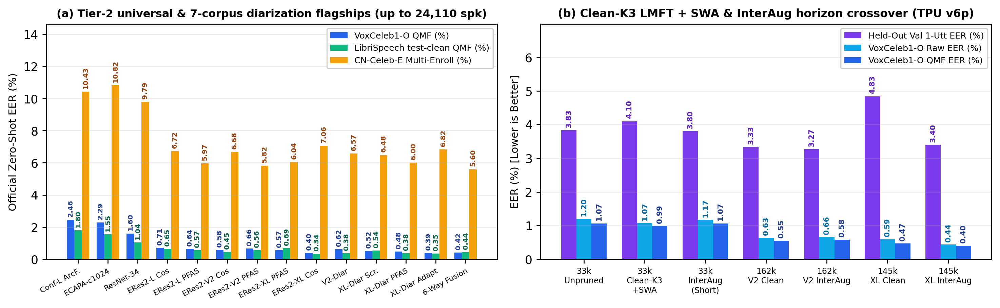
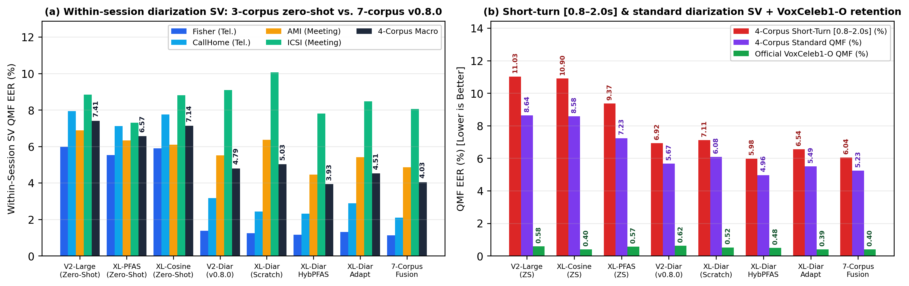
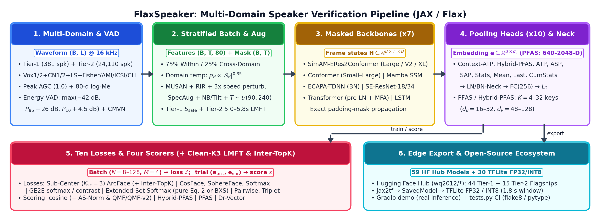
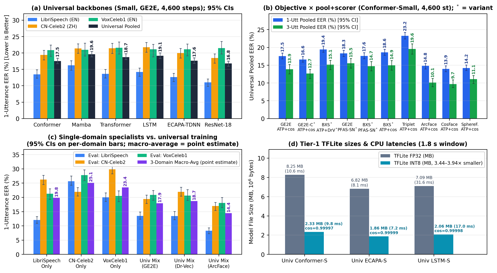

# FlaxSpeaker

[](https://github.com/wq2012/FlaxSpeaker/actions/workflows/python-app.yml) [](https://huggingface.co/collections/wq2012/flaxspeaker) [](https://pypi.python.org/pypi/flaxspeaker) [](https://pypi.org/project/flaxspeaker) [](https://pepy.tech/project/flaxspeaker) [](https://opensource.org/licenses/Apache-2.0)

## Overview

**FlaxSpeaker** (`v0.8.0`) is an open-source Python library built on [JAX](https://jax.readthedocs.io) and [Flax](https://flax.readthedocs.io) for **speaker verification** (*"Are these two audio recordings spoken by the same person?"*), **speaker embedding extraction**, and **diarization-ready conversational turn verification**.

**Do you need FlaxSpeaker?**
- **Drop-in Pretrained Speaker Verification & Diarization Embeddings**: Download one universal model from Hugging Face that works out of the box across English and Chinese, clean speech, noisy in-the-wild recordings, `8 kHz` telephone calls, and multi-party meetings—with ready-to-deploy **SafeTensors** and **FP32 / INT8 TFLite** edge models.
- **JAX / Flax Research & Education**: Train, compare, or customize **7 neural backbones** (`SimAM-ERes2Conformer`, `Conformer`, `ECAPA-TDNN`, `SE-ResNet`, `Mamba`, `Transformer`, `LSTM`), **10 temporal pooling heads** (`Context-ATP`, `Hybrid-PFAS`, `ATP`, `ASP`, `PFAS`), **10 metric / angular-margin losses** (`Sub-Center ArcFace + Inter-TopK`, `CosFace`, `GE2E`, `Dr-Vectors`), and overlap-aware diarization turn extraction (`flaxspeaker.diarization_prep`) in pure functional JAX (`jax.jit` / `jax.pmap`). For the companion PyTorch educational project, see [SpeakerRecognitionFromScratch](https://github.com/wq2012/SpeakerRecognitionFromScratch).

> **Note**: **This is not an officially supported Google product.** FlaxSpeaker is a clean-room open-source JAX/Flax implementation trained from scratch on public speech corpora; see [Reproduction Scope & Paper References](#5-reproduction-scope--paper-references).

### Which Pretrained Model Should You Use?

Pick the model that matches your deployment target—every flagship below is trained 100% from scratch across up to `24,110` speakers (`VoxCeleb1/2 + CN-Celeb1/2 + LibriSpeech-960h + Fisher + AMI + ICSI + CallHome` with `MUSAN + RIRS_NOISES`):

| Use Case | Recommended Hugging Face Model | Params (INT8 TFLite) | VoxCeleb1-O EER | CN-Celeb-E Multi-Enroll EER | Diarization 4-Corpus WS EER |
| :--- | :--- | :---: | :---: | :---: | :---: |
| **Best Overall / English / Edge TFLite (Recommended)** | **[`wq2012/univ_full_eres2conformer_xl_diar_adapt`](https://huggingface.co/wq2012/univ_full_eres2conformer_xl_diar_adapt)** | `64.4M` (`66.5 MB`) | **`0.39%`** (`0.47%` raw; **`1.57%`** INT8) | `6.82%` (`0.35%` LS) | `4.51%` (`1.31%` Fisher) |
| **Best Diarization / Telephone & Meetings (`Hybrid-PFAS`)** | **[`wq2012/univ_full_eres2conformer_xl_diar_pfas`](https://huggingface.co/wq2012/univ_full_eres2conformer_xl_diar_pfas)** | `77.0M` (SafeTensors) | `0.48%` (`0.50%` raw) | `6.00%` (`0.38%` LS) | **`3.93%`** (**`1.15%`** Fisher / **`4.45%`** AMI) |
| **Best Multi-Genre / Chinese (`Hybrid-PFAS`)** | **[`wq2012/univ_full_eres2conformer_v2_pfas`](https://huggingface.co/wq2012/univ_full_eres2conformer_v2_pfas)** | `46.5M` (SafeTensors) | `0.66%` (`0.73%` raw) | **`5.82%`** (**`6.25%`** 1-utt) | `6.08%` (`5.25%` Fisher) |
| **Best Pure Wideband Audiobook / Interview (`3`-Corpus)** | [`wq2012/univ_full_eres2conformer_xl`](https://huggingface.co/wq2012/univ_full_eres2conformer_xl) | `64.4M` (`66.4 MB`) | `0.40%` (`0.44%` raw) | `7.06%` (**`0.34% / 0.13%`** LS) | `7.14%` (`5.90%` Fisher) |
| **Compact 7-Corpus Cosine / Faster Edge TFLite** | [`wq2012/univ_full_eres2conformer_v2_diar`](https://huggingface.co/wq2012/univ_full_eres2conformer_v2_diar) | `36.3M` (`37.9 MB`) | `0.62%` (`1.96%` INT8) | `6.57%` (`0.38%` LS) | `4.79%` (`1.38%` Fisher) |
| **Fast Compact 1D Encoder** | [`wq2012/univ_full_ecapa_c1024_arcface`](https://huggingface.co/wq2012/univ_full_ecapa_c1024_arcface) | `14.9M` (`15.4 MB`) | `2.29%` (`2.54%` raw) | `10.82%` (`1.55%` LS) | `12.91%` (`11.63%` Fisher) |
| **Tiny CPU / Ablation Baseline** | [`wq2012/univ_conformer_small_cosface`](https://huggingface.co/wq2012/univ_conformer_small_cosface) | `2.0M` | — (`13.94%` 381-spk pooled) | — | — |

All **59 pretrained checkpoints** (`15` full-data universal & diarization flagships + `44` controlled ablation models) are hosted in the **[`wq2012/FlaxSpeaker` Hugging Face Collection](https://huggingface.co/collections/wq2012/flaxspeaker)**.

### Quickstart (Install & Run in 30 Seconds)

```bash
pip install -U flaxspeaker
```

Verify two audio files or extract a 256-D L2-normalized speaker embedding in Python:

```python
import flaxspeaker

# Automatically downloads from Hugging Face Hub on first use
model = flaxspeaker.load_pretrained("wq2012/univ_full_eres2conformer_xl_diar_adapt")

# 1. Compare two audio files (also accepts a list of enrollment files)
same_score = model.verify(
    "hf_space/examples/librispeech_spk1_utt1.flac",
    "hf_space/examples/librispeech_spk1_utt2.flac",
)
diff_score = model.verify(
    "hf_space/examples/librispeech_spk1_utt1.flac",
    "hf_space/examples/librispeech_spk2_utt1.flac",
)
print(f"Same speaker: {same_score:.4f} | Different speaker: {diff_score:.4f}")

# 2. Extract a 256-D L2-normalized speaker embedding (NumPy array)
embedding = model.extract_embedding("hf_space/examples/librispeech_spk1_utt1.flac")
```

Or run from the command line or launch the interactive [Gradio](https://gradio.app) web app:

```bash
python scripts/inference.py \
  --model_dir wq2012/univ_full_eres2conformer_xl_diar_adapt \
  --enroll_audio hf_space/examples/librispeech_spk1_utt1.flac \
  --test_audio hf_space/examples/librispeech_spk1_utt2.flac

python hf_space/app.py   # interactive Gradio demo (59 models, VAD & spectrogram plots)
```

### Where to Find Detailed Information

- **[1. Flagship Benchmarks & Architecture Ablation](#1-flagship-benchmarks--architecture-ablation)** — Full metrics across all 15 full-data flagships, conversational & meeting diarization SV (`v0.8.0`), score fusion, and our `v0.6.0–v0.8.0` ablations.
- **[2. System Architecture](#2-system-architecture)** — Overview of the 7 backbones, 10 pooling heads, 10 losses, diarization turn cropping, audio frontend, and FP32/INT8 TFLite export.
- **[3. CLI Workflows: Train, Evaluate & Export](#3-cli-workflows-train-evaluate--export)** — Commands to prepare standard and diarization datasets, train custom models, export to TFLite, and run tests.
- **[4. Controlled 44-Model Ablation Zoo](#4-controlled-44-model-ablation-zoo)** — Multi-domain vs. single-domain findings and collapsible tables for all 44 ablation checkpoints.
- **[5. Reproduction Scope & Paper References](#5-reproduction-scope--paper-references)** — Relationship to the GE2E, Dr-Vectors, ATP, and PFAS papers, source-paper deviations, and **[RESEARCH_REPORT.md](RESEARCH_REPORT.md)**.

---

## 1. Flagship Benchmarks & Architecture Ablation

Our 15 Tier-2 full-data flagships (`univ_full_*`) are trained 100% from scratch via `jax.pmap` on TPU accelerators across **`12,193` to `24,110` physical speakers** (`36,579` to `72,330` speed-perturbed classes across `VoxCeleb2-dev + VoxCeleb1-dev + CN-Celeb1/2 + LibriSpeech-960h` plus overlap-subtracted `Fisher + AMI + ICSI + CallHome` diarization turns in `v0.8.0`, up to `212` shuffled `float16` shards = `2,481,542` clean utterances / `7,435,874` `MUSAN + RIRS_NOISES`-augmented items) with zero speaker overlap against any evaluation split.



<!-- BEGIN README_FLAGSHIP_TABLE -->
| Hugging Face Repository | Backbone / Head / Objective | Params | Steps | VoxCeleb1-O Official (`37,611` trials) Raw / AS-Norm / QMF EER (%) | CN-Celeb-E Official (`3.48M` trials) Single Raw / QMF / Multi-Enroll EER (%) | LibriSpeech `test-clean` (`10,000` trials) 1-Utt Raw / QMF / 3-Utt EER (%) | Controlled 3-Domain Pooled 1-Utt / 3-Utt EER (%) | Controlled Macro-Avg 1-Utt / 3-Utt EER (%) |
| :--- | :--- | :---: | :---: | :---: | :---: | :---: | :---: | :---: |
| [`wq2012/univ_full_conformer_large_dr_vectors`](https://huggingface.co/wq2012/univ_full_conformer_large_dr_vectors) | `conformer` (`large`) / `atp` / `extended_set_softmax` (`dr_vector`) | `22,171,529` | `16,000` | 2.58% / 2.51% / 2.36% | 12.89% / 11.83% / 11.12% | 2.04% / 1.84% / 0.70% | 5.97% / 2.97% (raw 2.97%) | 5.58% / 3.10% |
| [`wq2012/univ_full_conformer_large_pfas`](https://huggingface.co/wq2012/univ_full_conformer_large_pfas) | `conformer` (`large`) / `pfas` / `extended_set_softmax` (`pfas`) | `22,582,159` | `24,000` | 2.79% / 2.78% / 2.57% | 12.36% / 11.18% / 10.43% | 2.05% / 1.99% / 0.77% | 6.36% / 3.87% (raw 3.87%) | 5.72% / 3.47% |
| [`wq2012/univ_full_ecapa_c1024_arcface`](https://huggingface.co/wq2012/univ_full_ecapa_c1024_arcface) | `ecapa_tdnn` (`large`) / `asp` / `arcface` (`cosine`) | `14,856,832` | `81,000` | 2.54% / 2.45% / 2.29% | 12.63% / 11.51% / 10.82% | 2.07% / 1.55% / 0.47% | 7.10% / 4.07% (raw 4.07%) | 5.48% / 3.13% |
| [`wq2012/univ_full_conformer_large_arcface`](https://huggingface.co/wq2012/univ_full_conformer_large_arcface) | `conformer` (`large`) / `atp` / `arcface` (`cosine`) | `22,005,636` | `81,000` | 2.66% / 2.66% / 2.46% | 11.78% / 11.04% / 10.43% | 2.19% / 1.80% / 0.43% | 7.53% / 3.47% (raw 3.97%) | 5.53% / 2.60% |
| [`wq2012/univ_full_resnet34_arcface`](https://huggingface.co/wq2012/univ_full_resnet34_arcface) | `resnet` (`large`) / `stats` / `arcface` (`cosine`) | `24,551,472` | `81,000` | 1.81% / 1.73% / 1.60% | 10.48% / 10.26% / 9.79% | 1.22% / 1.04% / 0.23% | 5.81% / 2.97% (raw 2.97%) | 4.56% / 2.33% |
| [`wq2012/univ_full_eres2conformer_large`](https://huggingface.co/wq2012/univ_full_eres2conformer_large) | `eres2conformer` (`large`) / `catp` / `subcenter_arcface` (`cosine`) | `31,834,352` | `93,000` | 0.84% / 0.85% / 0.71% | 7.83% / 7.45% / 6.72% | 0.72% / 0.65% / 0.40% | 4.30% / 2.30% (raw 2.30%) | 3.21% / 1.83% |
| [`wq2012/univ_full_eres2conformer_large_pfas`](https://huggingface.co/wq2012/univ_full_eres2conformer_large_pfas) | `eres2conformer` (`large`) / `hybrid_pfas` / `extended_set_softmax` (`hybrid_pfas`) | `41,979,244` | `24,000` | 0.70% / 0.78% / 0.64% | 7.16% / 6.50% / 5.97% | 0.69% / 0.57% / 0.33% | **2.96%** / **1.73%** (raw 1.73%) | **2.48%** / **1.27%** |
| [`wq2012/univ_full_eres2conformer_v2_large`](https://huggingface.co/wq2012/univ_full_eres2conformer_v2_large) | `eres2conformer` (`large`) / `catp` / `subcenter_arcface` (`cosine`) | `36,324,302` | `162,000` | 0.66% / 0.66% / 0.58% | 7.58% / 6.92% / 6.68% | 0.52% / 0.45% / **0.13%** | 4.35% / 2.27% (raw 2.27%) | 3.20% / 1.87% |
| [`wq2012/univ_full_eres2conformer_v2_pfas`](https://huggingface.co/wq2012/univ_full_eres2conformer_v2_pfas) | `eres2conformer` (`large`) / `hybrid_pfas` / `extended_set_softmax` (`hybrid_pfas`) | `46,469,194` | `24,000` | 0.73% / 0.78% / 0.66% | 6.82% / **6.25%** / **5.82%** | 0.77% / 0.56% / 0.37% | 3.40% / 1.87% (raw 1.87%) | 2.61% / 1.57% |
| [`wq2012/univ_full_eres2conformer_xl_pfas`](https://huggingface.co/wq2012/univ_full_eres2conformer_xl_pfas) | `eres2conformer` (`xl`) / `hybrid_pfas` / `extended_set_softmax` (`hybrid_pfas`) | `77,049,960` | `24,000` | 0.63% / 0.66% / 0.57% | 7.13% / 6.41% / 6.04% | 0.71% / 0.69% / 0.27% | 3.29% / 1.80% (raw 1.80%) | 2.69% / 1.53% |
| [`wq2012/univ_full_eres2conformer_xl`](https://huggingface.co/wq2012/univ_full_eres2conformer_xl) | `eres2conformer` (`xl`) / `catp` / `subcenter_arcface` (`cosine`) | `64,376,300` | `145,000` | 0.44% / 0.47% / 0.40% | 8.04% / 7.37% / 7.06% | 0.52% / **0.34%** / **0.13%** | 4.20% / 2.30% (raw 2.30%) | 3.03% / 1.80% |
| [`wq2012/univ_full_eres2conformer_v2_diar`](https://huggingface.co/wq2012/univ_full_eres2conformer_v2_diar) | `eres2conformer` (`large`) / `catp` / `subcenter_arcface` (`cosine`) | `36,324,302` | `78,000` | 0.64% / 0.66% / 0.62% | 7.57% / 7.10% / 6.57% | 0.48% / 0.38% / 0.20% | 4.04% / 1.90% (raw 1.90%) | 3.04% / 1.57% |
| [`wq2012/univ_full_eres2conformer_xl_diar`](https://huggingface.co/wq2012/univ_full_eres2conformer_xl_diar) | `eres2conformer` (`xl`) / `catp` / `subcenter_arcface` (`cosine`) | `64,376,300` | `162,000` | 0.57% / 0.60% / 0.52% | 7.55% / 7.23% / 6.48% | 0.77% / 0.54% / 0.20% | 4.16% / 2.07% (raw 2.07%) | 3.22% / 1.93% |
| [`wq2012/univ_full_eres2conformer_xl_diar_pfas`](https://huggingface.co/wq2012/univ_full_eres2conformer_xl_diar_pfas) | `eres2conformer` (`xl`) / `hybrid_pfas` / `extended_set_softmax` (`hybrid_pfas`) | `77,049,960` | `24,000` | 0.50% / 0.58% / 0.48% | 7.02% / 6.50% / 6.00% | 0.50% / 0.38% / 0.20% | 3.38% / 1.83% (raw 1.83%) | 2.58% / 1.47% |
| [`wq2012/univ_full_eres2conformer_xl_diar_adapt`](https://huggingface.co/wq2012/univ_full_eres2conformer_xl_diar_adapt) | `eres2conformer` (`xl`) / `catp` / `subcenter_arcface` (`cosine`) | `64,376,300` | `78,000` | 0.47% / 0.48% / **0.39%** | 7.99% / 7.32% / 6.82% | 0.44% / 0.35% / 0.23% | 3.88% / 2.13% (raw 2.13%) | 2.73% / 1.47% |
| **2-Way Score Fusion (`0.3·Conformer-L + 0.7·ECAPA-c1024`)** | Heterogeneous Cosine + AS-Norm + QMF | `36,862,468` | — | — / 2.20% / 2.01% | — / 10.44% / — | — / 1.62% / — | — | — |
| **3-Way Backbone Fusion (`0.25·Conf-L + 0.2·ECAPA + 0.55·ResNet-34`)** | 3-Architecture Cosine + AS-Norm + QMF | `61,413,940` | — | — / 1.62% / 1.43% | — / 9.37% / — | — / 1.14% / — | — | — |
| **4-Way Backbone Fusion (`0.02·Conf-L + 0.1·ECAPA + 0.2·ResNet-34 + 0.68·ERes2Conf`)** | 4-Architecture Cosine + AS-Norm + QMF | `93,248,292` | — | — / 0.85% / 0.69% | — / 7.62% / — | — / 0.74% / — | — | — |
| **6-Way Cosine Backbone Fusion (`Conf-L + ECAPA + ResNet-34 + ERes2Conf-L + V2-Large + XL`)** | 6-Backbone Pure Cosine + AS-Norm + QMF | `193,948,894` | — | — / 0.51% / 0.44% | — / 6.43% / — | — / 0.44% / — | — | — |
| **6-Way Flagship Fusion (`ERes2Conf Large/V2/XL Cosine + Large/V2/XL Hybrid-PFAS`)** | Heterogeneous 6-Way AS-Norm + QMF | `298,033,352` | — | — / 0.53% / 0.42% | — / **5.67%** / — | — / 0.44% / — | — | — |
| **4-Way 7-Corpus Diarization Fusion (`V2-Diar + XL-Diar + XL-Diar-Adapt + XL-Diar-PFAS`)** | 7-Corpus Cosine + Hybrid-PFAS QMF | `242,126,862` | — | — / **0.47%** / **0.40%** | — / 6.40% / 6.09% | — / 0.39% / **0.10%** | — | — |
| **6-Way Multi-Enroll Fusion** | Cosine AS-Norm + Frame-Level PFAS | `298,033,352` | — | — | — / — / **5.60%** (`AUC 0.9864`) | — / — / 0.33% (`AUC 1.0000`) | — | — |
<!-- END README_FLAGSHIP_TABLE -->

### Conversational Telephone & Multi-Party Meeting Diarization SV (`v0.8.0`)

Standard speaker encoders trained only on interviews and audiobooks degrade sharply when applied to speaker diarization: on `82,000` held-out trials extracted from **Fisher** (`8 kHz` telephone), **CallHome** (`8 kHz` telephone), **AMI** (`16 kHz` meeting microphones), and **ICSI** (`16 kHz` tabletop meetings), even `0.40%` VoxCeleb1-O `XL` yields **`5.90%`** Fisher within-session EER and **`7.14%`** 4-corpus macro within-session EER (`10.90%` on `0.8–2.0 s` short turns). Using [`flaxspeaker/diarization_prep.py`](flaxspeaker/diarization_prep.py) (`0.10 s` overlap-collar subtraction, `<= 0.30 s` same-speaker pause merging, `8 -> 16 kHz` polyphase resampling across `772,690` turns / `11,917` speakers), our `v0.8.0` 7-corpus flagships cut Fisher within-session QMF EER by **`4.5–5.1x`** (`5.90% -> 1.15%–1.31%`, and `0.74%–0.93%` standard QMF), reach **`3.93%`** 4-corpus macro within-session QMF EER on **`univ_full_eres2conformer_xl_diar_pfas`**, and reach a new best **`0.39%`** VoxCeleb1-O QMF EER (**`1.57%` INT8 TFLite**) on **`univ_full_eres2conformer_xl_diar_adapt`**:



<!-- BEGIN DIARIZATION_SV_TABLE -->
| Model / Regime | Train Corpora (`Spks`) | VoxCeleb1-O QMF (%) | Fisher (Tel.) WS / Std / Short QMF (%) | CallHome (Tel.) WS / Std / Short QMF (%) | AMI (Meeting) WS / Std / Short QMF (%) | ICSI (Meeting) WS / Std / Short QMF (%) | 4-Corpus Macro WS / Std / Short QMF (%) |
| :--- | :---: | :---: | :---: | :---: | :---: | :---: | :---: |
| [`wq2012/univ_full_ecapa_c1024_arcface`](https://huggingface.co/wq2012/univ_full_ecapa_c1024_arcface) (Zero-Shot) | 3-Corpus (`12,193`) | 2.29% | 11.63% / 11.30% / 16.90% | 13.55% / 14.17% / 16.20% | 12.12% / 13.20% / 18.23% | 14.35% / 17.53% / 20.70% | 12.91% / 14.05% / 18.01% |
| [`wq2012/univ_full_resnet34_arcface`](https://huggingface.co/wq2012/univ_full_resnet34_arcface) (Zero-Shot) | 3-Corpus (`12,193`) | 1.60% | 9.89% / 8.70% / 14.29% | 10.97% / 12.42% / 14.78% | 8.91% / 11.11% / 13.43% | 11.47% / 14.07% / 16.02% | 10.31% / 11.57% / 14.63% |
| [`wq2012/univ_full_eres2conformer_large`](https://huggingface.co/wq2012/univ_full_eres2conformer_large) (Zero-Shot) | 3-Corpus (`12,193`) | 0.71% | 8.41% / 7.41% / 13.29% | 8.53% / 9.52% / 12.90% | 7.25% / 8.30% / 10.23% | 9.65% / 11.80% / 13.82% | 8.46% / 9.26% / 12.56% |
| [`wq2012/univ_full_eres2conformer_v2_large`](https://huggingface.co/wq2012/univ_full_eres2conformer_v2_large) (Zero-Shot) | 3-Corpus (`12,193`) | 0.58% | 5.98% / 5.40% / 9.07% | 7.93% / 8.60% / 9.97% | 6.88% / 7.75% / 10.10% | 8.83% / 12.80% / 14.95% | 7.41% / 8.64% / 11.03% |
| [`wq2012/univ_full_eres2conformer_v2_pfas`](https://huggingface.co/wq2012/univ_full_eres2conformer_v2_pfas) (Zero-Shot) | 3-Corpus (`12,193`) | 0.66% | 5.25% / 4.61% / 7.58% | 6.68% / 7.13% / 8.18% | 5.33% / 6.80% / 8.60% | 7.05% / 9.78% / 11.38% | 6.08% / 7.08% / 8.93% |
| [`wq2012/univ_full_eres2conformer_xl_pfas`](https://huggingface.co/wq2012/univ_full_eres2conformer_xl_pfas) (Zero-Shot) | 3-Corpus (`12,193`) | 0.57% | 5.52% / 5.07% / 8.34% | 7.12% / 6.78% / 9.38% | 6.33% / 7.64% / 8.78% | 7.30% / 9.43% / 10.97% | 6.57% / 7.23% / 9.37% |
| [`wq2012/univ_full_eres2conformer_xl`](https://huggingface.co/wq2012/univ_full_eres2conformer_xl) (Zero-Shot) | 3-Corpus (`12,193`) | 0.40% | 5.90% / 5.46% / 9.28% | 7.75% / 7.97% / 9.88% | 6.10% / 8.40% / 9.40% | 8.80% / 12.48% / 15.05% | 7.14% / 8.58% / 10.90% |
| **[`wq2012/univ_full_eres2conformer_v2_diar`](https://huggingface.co/wq2012/univ_full_eres2conformer_v2_diar)** (`v0.8.0`) | 7-Corpus (`24,110`) | 0.62% | 1.38% / 0.97% / 1.88% | 3.17% / 3.08% / 3.50% | 5.51% / 5.75% / 7.75% | 9.08% / 12.87% / 14.57% | 4.79% / 5.67% / 6.92% |
| **[`wq2012/univ_full_eres2conformer_xl_diar`](https://huggingface.co/wq2012/univ_full_eres2conformer_xl_diar)** (`v0.8.0`) | 7-Corpus (`24,110`) | 0.52% | 1.24% / 0.92% / 1.30% | 2.43% / 2.47% / 3.20% | 6.36% / 6.89% / 8.85% | 10.07% / 14.03% / 15.10% | 5.03% / 6.08% / 7.11% |
| **[`wq2012/univ_full_eres2conformer_xl_diar_pfas`](https://huggingface.co/wq2012/univ_full_eres2conformer_xl_diar_pfas)** (`v0.8.0`) | 7-Corpus (`24,110`) | 0.48% | 1.15% / 0.74% / 1.39% | 2.32% / 2.50% / 3.50% | 4.45% / 5.12% / 7.37% | 7.80% / 11.47% / 11.65% | **3.93%** / **4.96%** / **5.98%** |
| **[`wq2012/univ_full_eres2conformer_xl_diar_adapt`](https://huggingface.co/wq2012/univ_full_eres2conformer_xl_diar_adapt)** (`v0.8.0`) | 7-Corpus (`24,110`) | **0.39%** | 1.31% / 0.93% / 1.68% | 2.88% / 2.85% / 3.55% | 5.40% / 5.90% / 8.20% | 8.47% / 12.28% / 12.75% | 4.51% / 5.49% / 6.54% |
| **4-Way 7-Corpus Score Fusion** | 7-Corpus (`24,110`) | 0.40% | 1.13% / 0.82% / 1.31% | 2.10% / 2.30% / 2.90% | 4.85% / 5.56% / 7.27% | 8.05% / 12.23% / 12.68% | 4.03% / 5.23% / 6.04% |
<!-- END DIARIZATION_SV_TABLE -->

<details>
<summary><strong>Click to expand the 7-Arm <code>v0.8.0</code> 7-Corpus Adaptation vs. Scratch &amp; Frozen vs. Unfrozen <code>Hybrid-PFAS</code> Ablation</strong></summary>

<!-- BEGIN V080_ABLATION_TABLE -->
| `v0.8.0` 7-Corpus Adaptation / Hybrid-PFAS Arm | Steps | Trunk Regime | VoxCeleb1-O Raw / QMF (%) | CN-Celeb-E Multi-Enroll (%) | Fisher WS Raw / QMF (%) | AMI WS Raw / QMF (%) | 4-Corpus Macro WS / Std / Short QMF (%) |
| :--- | :---: | :--- | :---: | :---: | :---: | :---: | :---: |
| 1. `XL-Diar-Adapt` (Gentle `lr=0.012`, `41k` steps) | `41,000` | Unfrozen SGD (`lr=0.012`) | 0.52% / 0.45% | 6.80% | 2.43% / 1.80% | 5.65% / 5.16% | 4.72% / 5.86% / 6.67% |
| **2. `XL-Diar-Adapt` (`lr=0.045`, `78k` = `3k + 65k + 10k` Bimodal LMFT) [Released]** | `78,000` | 3k Head Align + Unfrozen SGD (`0.045`) | 0.47% / 0.39% | 6.82% | 1.77% / 1.31% | 6.75% / 5.40% | 4.51% / 5.49% / 6.54% |
| 3. `XL-Diar` (`162k` = `150k + 12k` 100% From-Scratch) [Released] | `162,000` | 100% From-Scratch SGD (`lr=0.10`) | 0.57% / 0.52% | 6.48% | 1.60% / 1.24% | 8.69% / 6.36% | 5.03% / 6.08% / 7.11% |
| 4. `XL-Diar-PFAS` (`trunk_lr_mult=0.02`, `20k` ep.) | `20,000` | Jointly Unfrozen AdamW (`0.02×`) | 1.00% / 0.85% | 6.33% | 2.87% / 2.22% | 4.19% / 4.19% | 4.07% / 5.14% / 6.20% |
| 5. `XL-Diar-PFAS` (`trunk_lr_mult=0.004`, `15k` ep.) | `20,000` | Micro-Unfrozen AdamW (`0.004×`) | 0.92% / 0.83% | 6.90% | 3.54% / 2.38% | 4.97% / 4.42% | 4.09% / 5.14% / 6.24% |
| 6. `XL-Diar-PFAS` (`100%` Frozen on Gentle `41k` trunk, `20k` ep.) | `20,000` | 100% Frozen Trunk (`trunk_lr=0`) | 0.70% / 0.71% | 5.98% | 1.48% / 1.34% | 5.67% / 4.88% | 4.13% / 5.30% / 5.49% |
| **7. `XL-Diar-PFAS` (`100%` Frozen on `78k` `XL-Diar-Adapt` trunk) [Released]** | `24,000` | 100% Frozen Trunk (`trunk_lr=0`) | 0.50% / 0.48% | 6.00% | 1.21% / 1.15% | 5.51% / 4.45% | 3.93% / 4.96% / 5.98% |
<!-- END V080_ABLATION_TABLE -->

</details>

### Scaling to Sub-0.5% VoxCeleb1-O & Sub-6% CN-Celeb-E (`v0.7.0` Ablations)

Building on our `v0.6.0` `SimAM-ERes2Conformer` synthesis (`27,500`-step optimizer & Conformer block ablation in [`pretrained_models/eres2conformer_ablation_results.json`](pretrained_models/eres2conformer_ablation_results.json)), `v0.7.0` evaluated four directions across `7` controlled `33,000`-step TPU v6p arms and `4` matched full-corpus (`145`-shard, `145k–162k`-step) runs ([`pretrained_models/v070_ablation_results.json`](pretrained_models/v070_ablation_results.json)):
1. **`Clean-K3 LMFT` + SWA + Exact Population `BatchNorm` + `QMF-v2`**: Pruning `@sp0.9/@sp1.1` speed-perturbed self-impostor rows during `5.6–5.8 s` Stage-2 LMFT while retaining `K=3` sub-centers per speaker (`prune_class_weights_for_clean_lmft(..., collapse_subcenters=False)`), averaging late checkpoints (`soup_checkpoints`), and recomputing exact population running statistics (`recompute_clean_batch_stats`) improves VoxCeleb1-O from `1.07%` to **`0.99%` QMF** at `33k` steps (whereas collapsing `K=3 -> Medoid K=1` degrades multi-genre CN-Celeb-E from `6.47%` to `8.49%`).
2. **2D Frequency-Channel Coordinate SE (`2D-fwSE`), 3-Stage `(2+3+4)` MFA & `XL` (`64.4M`) Scaling**: Adding frequency-bin + channel coordinate SE inside every 2D `SERes2Net` block, fusing Stages `2 + 3 + 4` before flattening, and scaling to `XL` (`C_0=80, (3,4,8,3), 4 x 640-D` Conformer blocks) with **`Inter-TopK` (`K=5, m=0.06`) + Narrowband/Tilt `SpecAugment`** exhibits a clear **horizon-regularization crossover**: neutral at `33k` steps, `InterAug` prevents classifier over-fitting at `145k–162k` steps (`XL-64M` Clean `4.83%` val 1-utt EER vs. `InterAug` **`3.40%`** val 1-utt EER) and drives **`univ_full_eres2conformer_xl`** to **`0.40%` QMF / `0.44%` raw EER** on VoxCeleb1-O and **`0.34% / 0.13%`** on LibriSpeech `test-clean`.
3. **Hybrid Cosine + Residual Attentive Scoring (`Hybrid-PFAS`)**: Training an episodic `8`-key `PFAS-SN` cross-attention head (`24,000` episodes) on top of a **frozen** angular-margin trunk preserves the exact `256-D` cosine geometry while resolving cross-genre multi-enrollment variation (`(1 - alpha)*cos + alpha*PFAS`), lowering CN-Celeb-E Multi-Enroll EER from `6.68%` to **`5.82%`** (`6.25%` Single QMF) on **`univ_full_eres2conformer_v2_pfas`** (`5.60%` with 6-way fusion).

<!-- BEGIN V070_HORIZON_TABLE -->
| Full-Corpus Long-Horizon Run (`145` Shards / `1.71M` Clean Utts / `4.35M` Items) | Steps | Final Train Loss | Held-Out Val 1-Utt / Composite EER (%) | VoxCeleb1-O Raw / AS-Norm / QMF EER (%) | CN-Celeb-E Single QMF / Multi-Enroll EER (%) | LibriSpeech 1-Utt QMF / 3-Utt EER (%) |
| :--- | :---: | :---: | :---: | :---: | :---: | :---: |
| `V2-Large` (`36.32M`) — Clean Recipe (`0 / 0 / 0`) | `162,000` | `2.2003` | 3.33% / 3.07% | 0.63% / 0.63% / 0.55% | 6.78% / 6.42% | 0.47% / 0.30% |
| **`V2-Large` (`36.32M`) — `InterAug` (`K=5, m=0.06, NB 0.20, Tilt 0.25`) [Val Winner]** | `162,000` | `1.4795` | **3.27% / 2.87%** | **0.66% / 0.66% / 0.58%** | 6.92% / 6.68% | 0.45% / 0.13% |
| `XL-64M` (`64.38M`) — Clean Recipe (`0 / 0 / 0`) | `145,000` | `1.0094` | 4.83% / 4.02% | 0.59% / 0.48% / 0.47% | 7.63% / 7.15% | 0.36% / 0.27% |
| **`XL-64M` (`64.38M`) — `InterAug` (`K=5, m=0.06, NB 0.20, Tilt 0.25`) [Val Winner]** | `145,000` | `1.6188` | **3.40% / 3.23%** | **0.44% / 0.47% / 0.40%** | 7.37% / 7.06% | 0.34% / 0.13% |
<!-- END V070_HORIZON_TABLE -->

<details>
<summary><strong>Click to expand the 7-Arm Controlled <code>v0.7.0</code> Ablation &amp; 3-Arm <code>v0.6.0</code> Architecture/Optimizer Ablation</strong></summary>

<!-- BEGIN V070_ABLATION_TABLE -->
| Controlled `v0.7.0` Arm (`113` Shards / `1.26M` Clean Utts, TPU v6p, Batch `512`) | Params | Steps | VoxCeleb1-O Raw / AS-Norm / QMF EER (%) | CN-Celeb-E Single Raw / QMF / Multi-Enroll EER (%) | LibriSpeech `test-clean` 1-Utt Raw / QMF / 3-Utt EER (%) | Controlled Pooled 1/3-Utt EER (%) |
| :--- | :---: | :---: | :---: | :---: | :---: | :---: |
| 1. Base `ERes2Conf-L` (`33k` = `30k` + `3k` unpruned LMFT) | `31,834,352` | `33,000` | 1.20% / 1.19% / 1.07% | 7.42% / 6.80% / 6.47% | 0.99% / 0.78% / 0.27% | 4.03% / 2.00% |
| 2. `+ Medoid K=1` collapse (`33k`, collapses intra-spk modes) | `31,834,352` | `33,000` | 1.47% / 1.34% / 1.25% | 9.88% / 8.96% / 8.49% | 1.19% / 0.72% / 0.17% | 5.14% / 2.90% |
| 3. `+ Clean-K3 LMFT + SWA + Exact BN + QMF-v2` (`33k`) | `31,834,352` | `33,000` | 1.07% / 1.07% / 0.99% | 7.55% / 6.86% / 6.56% | 0.90% / 0.57% / 0.23% | 4.78% / 2.70% |
| 4. `+ Inter-TopK (K=5, 0.06) + NB/Tilt` at short `33k` horizon | `31,834,352` | `33,000` | 1.17% / 1.14% / 1.07% | 7.62% / 7.18% / 6.72% | 0.82% / 0.69% / 0.30% | 4.15% / 2.00% |
| 5. `V2-Large` (`2D-fwSE + 3-Stage MFA + 3x Conf`, `33k` Clean) | `36,324,302` | `33,000` | 1.17% / 1.18% / 1.04% | 7.59% / 7.00% / 6.79% | 0.99% / 0.65% / 0.17% | 4.60% / 2.50% |
| 6. `XL-64M` (`C=80, (3,4,8,3), 4x640D Conf`, `28k` Clean) | `64,376,300` | `33,000` | 1.18% / 1.16% / 1.08% | 7.37% / 7.04% / 6.52% | 0.93% / 0.78% / 0.13% | 4.04% / 2.17% |
| 7. `+ Hybrid-PFAS` (`20k` episodes on frozen `Large` trunk) | `41,979,244` | `12,000` | 0.78% / 0.84% / 0.67% | 7.31% / 7.11% / 6.58% | 0.74% / 0.60% / 0.43% | 3.74% / 2.17% |
<!-- END V070_ABLATION_TABLE -->

<!-- BEGIN ERES2CONF_ABLATION_TABLE -->
| Ablation Arm (`27,500` steps = `25k` Stage-1 + `2.5k` `5.0 s` LMFT, batch `512`) | Conformer Blocks | Optimizer | Params | VoxCeleb1-O Raw / AS-Norm / QMF EER (%) | CN-Celeb-E Single Raw / QMF / Multi-Enroll EER (%) | LibriSpeech `test-clean` 1-Utt Raw / QMF / 3-Utt EER (%) | Controlled Pooled 1/3-Utt EER (%) | Controlled Macro 1/3-Utt EER (%) |
| :--- | :---: | :---: | :---: | :---: | :---: | :---: | :---: | :---: |
| **`eres2conformer_catp_sgd`** | `2` | `sgd` | `31,834,352` | 1.83% / 1.69% / **1.61%** | 10.21% / **8.94%** / **8.83%** | 1.37% / **1.01%** / **0.23%** | **6.14%** / **3.50%** | **4.31%** / **2.77%** |
| `eres2net_noconf_catp_sgd` | `0` | `sgd` | `20,846,816` | 2.04% / 1.95% / 1.85% | 10.62% / 9.20% / 8.97% | 1.56% / 1.16% / 0.33% | 6.56% / 3.87% | 4.57% / 2.77% |
| `eres2conformer_catp_adamw` | `2` | `adamw` | `31,834,352` | 2.19% / 2.09% / 1.90% | 11.10% / 9.87% / 9.55% | 1.57% / 1.19% / 0.43% | 6.53% / 4.17% | 4.73% / 2.73% |
<!-- END ERES2CONF_ABLATION_TABLE -->

</details>

---

## 2. System Architecture



All components share a unified, padding-mask-invariant `(B, T, F) -> (B, T, D)` interface configured via typed `ExperimentConfig` YAML/JSON files (full mathematical details in [RESEARCH_REPORT.md](RESEARCH_REPORT.md)):

- **7 Sequence Backbones ([`flaxspeaker/backbones.py`](flaxspeaker/backbones.py))**:
  - **SimAM-ERes2Conformer** (`eres2conformer`): 4-stage 2D multi-scale `ERes2NetV2` + `AFF` + 3D `SimAM` + optional `2D-fwSE` stem, Stage-`3/4` or `2/3/4` `MFA`, and `RoPE + QK-Norm + BatchNorm` Macaron Conformer blocks (`31.83M` in `large`, `36.32M` in `v2_large`, `64.38M` in `xl`).
  - **SE-ResNet** (`resnet`): 2D time-frequency residual CNN with Squeeze-and-Excitation (`SE-ResNet-18` `2.24M` and `SE-ResNet-34` `24.55M`).
  - **Conformer** (`conformer`): Macaron FFN + Masked MHSA + GroupNorm Depthwise Conv + MFA (`tiny` to `large`).
  - **ECAPA-TDNN** (`ecapa_tdnn`): 1D dilated SE-Res2Net blocks with running-statistics `BatchNorm` after activation and MFA (`c=1024` in `large`).
  - **Mamba** (`mamba`): Linear-time Selective State Space Model via `jax.lax.associative_scan` (unidirectional or bidirectional).
  - **Transformer** (`transformer`) & **LSTM** (`lstm`): Pre-LN MHSA + MFA, and mask-aware uni-/bidirectional stacked LSTMs.
- **10 Temporal Pooling Heads ([`flaxspeaker/pooling.py`](flaxspeaker/pooling.py))**:
  - **Context-ATP** (`catp`, 16 channel-subspace sigmoid heads conditioned on utterance mean/std + `BN-Neck`), **Hybrid-PFAS** (`hybrid_pfas`, `256-D` `catp` cosine slice + cross-utterance `PFAS-SN` keys/values), **ATP** (`atp`), **ASP** (`asp`), **SAP** (`sap`), **Stats** (`stats`), **Mean** (`mean`), **Last** (`last`), causal **Cumulative Stats** (`cumulative_stats`), and multi-key **PFAS** (`pfas`: `atp_ffn` and `shared_nonlinear` PFAS-SN).
- **10 Training Objectives & 4 Scorers ([`flaxspeaker/losses.py`](flaxspeaker/losses.py), [`flaxspeaker/scoring.py`](flaxspeaker/scoring.py))**:
  - **Angular Margin**: `Sub-Center ArcFace (K=3)` (`subcenter_arcface` / `arcface` with linear `margin_warmup_steps`, `Inter-TopK` hard-impostor penalty, `decay_class_weights`, and `Clean-K3 LMFT`), `CosFace` (`cosface`), `SphereFace` (`sphereface`), and `Softmax` (`softmax`).
  - **Metric & End-to-End Scoring**: `GE2E-Softmax` (`ge2e_softmax`), `GE2E-Contrast` (`ge2e_contrast`), `Extended-Set Softmax` (`extended_set_softmax`, pure and blended BXS), `Triplet` (`triplet`), and `Pairwise` (`pairwise`), paired with **Cosine**, **Hybrid-PFAS** (`hybrid_pfas`), **Dr-Vectors** (`dr_vector`), or **PFAS** (`pfas`) scoring plus Top-300 **AS-Norm** and cohort-aware **QMF-v2** calibration.
- **Frontend, Diarization Prep, Sharded Data & Edge Export ([`flaxspeaker/feature_extraction.py`](flaxspeaker/feature_extraction.py), [`flaxspeaker/diarization_prep.py`](flaxspeaker/diarization_prep.py), [`flaxspeaker/export.py`](flaxspeaker/export.py))**:
  - 16 kHz 80-D log-Mel + adaptive frame-level energy VAD + CMVN, RTTM/CTM/JSONL overlap-subtracted diarization turn cropping (`extract_clean_speaker_segments` with `0.10 s` collar and `<= 0.30 s` pause merging), `MUSAN` + `RIRS_NOISES` + `3x` speed perturbation + narrowband/tilt `SpecAugment` into memory-mapped `float16` shards, and non-XLA `jax2tf` export to **FP32 / INT8 TFLite** (`3.44–3.94x` size reduction across `30` exported binaries in `15` repos with at most `0.14 pp` EER change; **`1.58%` FP32 -> `1.57%` INT8** on `univ_full_eres2conformer_xl_diar_adapt`, `1.61% -> 1.62%` on `univ_full_eres2conformer_xl_diar`, and `1.67% -> 1.70%` on `univ_full_eres2conformer_xl`).

---

## 3. CLI Workflows: Train, Evaluate & Export

For development, Hugging Face Hub, and TFLite export extras:

```bash
pip install -e ".[dev,export,hf]"
```

### Prepare Datasets & `float16` Shards
```bash
# Controlled 381-speaker benchmark splits (LibriSpeech + CN-Celeb2 + VoxCeleb1)
python scripts/prepare_datasets.py --data_root ./data/speaker_datasets
python scripts/prepare_controlled_shards.py --data_root ./data/speaker_datasets

# Full 12,193-speaker multi-corpus datasets (VoxCeleb1/2 + CN-Celeb1/2 + LibriSpeech-960h + MUSAN + RIRS)
python scripts/download_full_corpora.py
python scripts/prepare_full_corpora_shards.py

# Overlap-subtracted speaker encoder datasets & verification trials from diarization RTTM/CTM/JSONL
python scripts/prepare_diarization_dataset.py \
  --rttm_dir ./data/ami/rttm --audio_dir ./data/ami/audio \
  --output_dir ./data/ami_speaker_sv --corpus_name ami
```

### Train Custom Models or Reproduce Flagships
```bash
# Train a single model from any YAML config in configs/*.yml
python scripts/train.py \
  --config configs/univ_conformer_small_cosface.yml \
  --train_csv ./data/speaker_datasets/splits/universal/train.csv \
  --eval_csv ./data/speaker_datasets/splits/universal/eval.csv \
  --trials_file ./data/speaker_datasets/splits/universal/trials.tsv \
  --output_dir ./checkpoints/univ_conformer_small_cosface

# Run the full-data multi-device flagship training pipeline or 16-config PFAS sweep
python scripts/train_full_data_flagships.py
python scripts/run_pfas_hparam_sweep.py
```

### Evaluate & Export to TFLite / Hugging Face Hub
```bash
# Evaluate 1-utterance and multi-utterance verification trials
python scripts/evaluate.py \
  --model_dir wq2012/univ_full_eres2conformer_xl_diar_adapt \
  --trials_file ./data/speaker_datasets/splits/universal/trials.tsv \
  --multi_trials_file ./data/speaker_datasets/splits/universal/multi_enroll_trials.tsv \
  --output_json eval_summary.json

# Export any cosine-scored checkpoint to FP32 and dynamic-range INT8 TFLite
python scripts/export_model.py \
  --model_dir wq2012/univ_full_eres2conformer_xl_diar_adapt \
  --output_dir ./exported_models/univ_full_eres2conformer_xl_diar_adapt \
  --export_tflite --quantize_int8

# Evaluate all exported TFLite models and regenerate Hub model cards
python scripts/eval_tflite_models.py --data_root ./data/speaker_datasets --models_dir ./pretrained_models
python scripts/update_hf_model_cards.py --push --include_weights
```

### Run Unit Tests, Linting & Benchmark Reproducers
```bash
pytest -v tests.py
flake8 .
pytype .
./run_pdoc.sh

# Reproduce Tier-1 ablations, multi-seed controls, provenance checks & paper figures
python scripts/run_phase1_convergence_pilot.py --data_root ./data/speaker_datasets
python scripts/run_research_benchmarks.py --data_root ./data/speaker_datasets
python scripts/run_r1_ablations.py --data_root ./data/speaker_datasets
python scripts/run_r2_controls.py --data_root ./data/speaker_datasets
python scripts/eval_vox1_o_subset.py --data_root ./data/speaker_datasets --models_dir ./pretrained_models
python scripts/fingerprint_released_checkpoints.py --data_root ./data/speaker_datasets
python scripts/write_training_provenance.py
python scripts/generate_report_tables.py --section all > /tmp/report_tables.md
python scripts/generate_paper_tables.py --paper_dir ../flax_speaker_paper
python scripts/generate_figures.py --benchmark-json pretrained_models/benchmark_results.json --output-dir ./figures
```

---

## 4. Controlled 44-Model Ablation Zoo

Alongside the 15 full-data flagships, we release **44 controlled CPU-trained models** (`0.63M–4.55M` params) trained on speaker-disjoint subsets (`381` speakers / `9,447` utterances across LibriSpeech, CN-Celeb2, and VoxCeleb1) to isolate backbone, pooling, loss, and multi-domain effects under identical conditions:



- **Universal Multi-Domain Beats Single-Domain Specialists (`19 / 19` Pairs)**: Every universal `univ_*` model outperforms its matched LibriSpeech-only `ls_*` specialist on pooled 1-utt, macro 1-utt, and pooled 3-utt EER—including by **`3.88` percentage points** (`16.32%` vs. `20.20%`) when subsampled to the exact same utterance count (`5,788`) and step budget (`2,400` steps).
- **Angular-Margin Crossover**: With linear margin warm-up (`margin_warmup_steps=500`), `CosFace` (`13.94%` pooled 1-utt / `9.67%` 3-utt), `SphereFace` (`14.20%`), and `Sub-Center ArcFace` (`14.80%`) lead all 19 controlled universal models.

| Model Paradigm | Representative Checkpoint (`Steps`) | LS 1-Utt / 3-Utt EER (%) | CN 1-Utt / 3-Utt EER (%) | VOX 1-Utt / 3-Utt EER (%) | Universal Macro-Avg 1-Utt / 3-Utt EER (%) | Universal Pooled 1-Utt / 3-Utt EER (%) |
| :--- | :--- | :---: | :---: | :---: | :---: | :---: |
| **LibriSpeech-Only Specialist (`GE2E`)** | [`wq2012/ls_conformer_small_ge2e`](https://huggingface.co/wq2012/ls_conformer_small_ge2e) (`2,400`) | 12.07% / 7.50% | 26.20% / 23.20% | 21.25% / 18.50% | 19.84% / 16.40% | 20.20% / 16.93% |
| **Universal Multi-Domain (`GE2E`)** | [`wq2012/univ_conformer_small_ge2e`](https://huggingface.co/wq2012/univ_conformer_small_ge2e) (`4,600`) | 13.47% / 9.20% | 19.40% / 16.30% | 20.85% / 16.40% | 17.91% / 13.97% | 17.54% / 13.87% |
| **LibriSpeech-Only Specialist (`ArcFace`)** | [`wq2012/ls_conformer_small_arcface`](https://huggingface.co/wq2012/ls_conformer_small_arcface) (`2,400`) | 8.13% / 4.20% | 21.80% / 18.20% | 17.65% / 13.60% | 15.86% / 12.00% | 16.23% / 12.40% |
| **Universal Multi-Domain (`CosFace`)** | [`wq2012/univ_conformer_small_cosface`](https://huggingface.co/wq2012/univ_conformer_small_cosface) (`4,600`) | 7.67% / 3.80% | 16.73% / 11.90% | 17.05% / 11.80% | 13.82% / 9.17% | 13.94% / 9.67% |
| **Full-Data Flagship (`SimAM-ERes2Conformer-XL`)** | [`wq2012/univ_full_eres2conformer_xl`](https://huggingface.co/wq2012/univ_full_eres2conformer_xl) (`145,000`) | **0.47%** / **0.20%** | 8.23% / 5.20% | **0.40%** / **0.00%** | 3.03% / 1.80% | 4.20% / 2.30% |
| **Full-Data Flagship (`Hybrid-PFAS` `Large`)** | [`wq2012/univ_full_eres2conformer_large_pfas`](https://huggingface.co/wq2012/univ_full_eres2conformer_large_pfas) (`24,000`) | 0.67% / **0.20%** | **6.10%** / **3.60%** | 0.68% / **0.00%** | **2.48%** / **1.27%** | **2.96%** / **1.73%** |

<details>
<summary><strong>Click to expand all 19 Tier-1 Universal Multi-Domain Models (<code>univ_*</code>)</strong></summary>

<!-- BEGIN README_UNIV_TABLE -->
| Hugging Face Repository | Steps | Backbone / Size | Pooling / Loss / Scoring | Params | LS 1-Utt / 3-Utt EER (%) | CN 1-Utt / 3-Utt EER (%) | VOX 1-Utt / 3-Utt EER (%) | Macro-Avg 1-Utt / 3-Utt EER (%) | Pooled 1-Utt / 3-Utt EER (%) | Macro 1-Utt / 3-Utt minDCF@0.01 |
| :--- | :---: | :--- | :--- | :---: | :---: | :---: | :---: | :---: | :---: | :---: |
| [`wq2012/univ_conformer_small_cosface`](https://huggingface.co/wq2012/univ_conformer_small_cosface) | `4,600` | `conformer` (`small`) | `atp` / `cosface` / `cosine` | `2,029,892` | **7.67%** / **3.80%** | **16.73%** / **11.90%** | **17.05%** / **11.80%** | **13.82%** / **9.17%** | **13.94%** / **9.67%** | `0.7159` / `0.5180` |
| [`wq2012/univ_conformer_small_sphereface`](https://huggingface.co/wq2012/univ_conformer_small_sphereface) | `4,600` | `conformer` (`small`) | `atp` / `sphereface` / `cosine` | `2,029,892` | 8.00% / 4.20% | 17.00% / 12.00% | 18.40% / 14.20% | 14.47% / 10.13% | 14.20% / 11.07% | `0.7021` / **`0.5100`** |
| [`wq2012/univ_conformer_small_arcface`](https://huggingface.co/wq2012/univ_conformer_small_arcface) | `4,600` | `conformer` (`small`) | `atp` / `arcface` / `cosine` | `2,029,892` | 8.27% / 4.60% | 16.93% / 12.60% | 18.05% / 12.30% | 14.42% / 9.83% | 14.80% / 10.10% | **`0.6943`** / `0.6440` |
| [`wq2012/univ_conformer_small_ge2e_contrast`](https://huggingface.co/wq2012/univ_conformer_small_ge2e_contrast) | `4,600` | `conformer` (`small`) | `atp` / `ge2e_contrast` / `cosine` | `2,029,894` | 10.00% / 6.90% | 18.63% / 14.10% | 19.25% / 16.00% | 15.96% / 12.33% | 16.56% / 12.67% | `0.7788` / `0.6440` |
| [`wq2012/univ_resnet_small_ge2e`](https://huggingface.co/wq2012/univ_resnet_small_ge2e) | `4,600` | `resnet` (`small`) | `asp` / `ge2e_softmax` / `cosine` | `2,239,922` | 11.03% / 5.70% | 18.47% / 12.70% | 21.45% / 17.90% | 16.98% / 12.10% | 16.79% / 12.57% | `0.7926` / `0.8053` |
| [`wq2012/univ_conformer_tiny_ge2e`](https://huggingface.co/wq2012/univ_conformer_tiny_ge2e) | `4,600` | `conformer` (`tiny`) | `atp` / `ge2e_softmax` / `cosine` | `693,126` | 12.10% / 7.80% | 18.73% / 15.00% | 20.60% / 16.40% | 17.14% / 13.07% | 16.93% / 13.03% | `0.9275` / `0.7800` |
| [`wq2012/univ_ecapa_tdnn_base_ge2e`](https://huggingface.co/wq2012/univ_ecapa_tdnn_base_ge2e) | `4,600` | `ecapa_tdnn` (`base`) | `asp` / `ge2e_softmax` / `cosine` | `3,190,626` | 11.73% / 7.90% | 20.10% / 15.70% | 20.20% / 17.20% | 17.34% / 13.60% | 17.25% / 14.00% | `0.9028` / `0.7533` |
| [`wq2012/univ_conformer_small_ge2e`](https://huggingface.co/wq2012/univ_conformer_small_ge2e) | `4,600` | `conformer` (`small`) | `atp` / `ge2e_softmax` / `cosine` | `2,029,894` | 13.47% / 9.20% | 19.40% / 16.30% | 20.85% / 16.40% | 17.91% / 13.97% | 17.54% / 13.87% | `0.9139` / `0.8227` |
| [`wq2012/univ_conformer_small_pfas`](https://huggingface.co/wq2012/univ_conformer_small_pfas) | `4,600` | `conformer` (`small`) | `pfas` / `extended_set_softmax` / `pfas` | `2,162,187` | 11.73% / 8.10% | 20.93% / 18.80% | 19.45% / 16.20% | 17.37% / 14.37% | 17.60% / 14.70% | `0.8726` / `0.7607` |
| [`wq2012/univ_ecapa_tdnn_small_ge2e`](https://huggingface.co/wq2012/univ_ecapa_tdnn_small_ge2e) | `4,600` | `ecapa_tdnn` (`small`) | `asp` / `ge2e_softmax` / `cosine` | `1,684,418` | 12.60% / 8.60% | 19.93% / 15.40% | 21.10% / 18.00% | 17.88% / 14.00% | 17.62% / 14.07% | `0.9548` / `0.8473` |
| [`wq2012/univ_ecapa_tdnn_tiny_ge2e`](https://huggingface.co/wq2012/univ_ecapa_tdnn_tiny_ge2e) | `4,600` | `ecapa_tdnn` (`tiny`) | `asp` / `ge2e_softmax` / `cosine` | `626,722` | 13.00% / 8.50% | 20.17% / 16.00% | 20.10% / 16.30% | 17.76% / 13.60% | 17.80% / 14.20% | `0.9285` / `0.8100` |
| [`wq2012/univ_conformer_base_ge2e`](https://huggingface.co/wq2012/univ_conformer_base_ge2e) | `4,600` | `conformer` (`base`) | `atp` / `ge2e_softmax` / `cosine` | `4,551,558` | 12.83% / 8.70% | 19.53% / 15.60% | 21.90% / 17.00% | 18.09% / 13.77% | 17.90% / 14.40% | `0.9341` / `0.7893` |
| [`wq2012/univ_conformer_small_pfas_ge2e`](https://huggingface.co/wq2012/univ_conformer_small_pfas_ge2e) | `4,600` | `conformer` (`small`) | `pfas` / `ge2e_softmax` / `pfas` | `2,162,187` | 12.57% / 9.80% | 20.60% / 17.90% | 20.40% / 16.40% | 17.86% / 14.70% | 18.31% / 15.53% | `0.8347` / `0.7593` |
| [`wq2012/univ_conformer_small_ext_softmax`](https://huggingface.co/wq2012/univ_conformer_small_ext_softmax) | `4,600` | `conformer` (`small`) | `atp` / `extended_set_softmax` / `cosine` | `2,029,894` | 13.03% / 9.00% | 20.80% / 16.30% | 21.50% / 16.40% | 18.44% / 13.90% | 18.61% / 14.93% | `0.9206` / `0.7707` |
| [`wq2012/univ_transformer_small_ge2e`](https://huggingface.co/wq2012/univ_transformer_small_ge2e) | `4,600` | `transformer` (`small`) | `atp` / `ge2e_softmax` / `cosine` | `1,239,622` | 13.63% / 10.10% | 21.43% / 16.50% | 21.55% / 16.60% | 18.87% / 14.40% | 18.73% / 14.87% | `0.8972` / `0.8613` |
| [`wq2012/univ_lstm_small_ge2e`](https://huggingface.co/wq2012/univ_lstm_small_ge2e) | `4,600` | `lstm` (`small`) | `asp` / `ge2e_softmax` / `cosine` | `1,710,914` | 14.17% / 9.60% | 21.73% / 16.20% | 21.10% / 17.30% | 19.00% / 14.37% | 19.14% / 14.87% | `0.9560` / `0.9040` |
| [`wq2012/univ_conformer_small_dr_vectors`](https://huggingface.co/wq2012/univ_conformer_small_dr_vectors) | `4,600` | `conformer` (`small`) | `atp` / `extended_set_softmax` / `dr_vector` | `2,088,007` | 13.43% / 10.20% | 21.93% / 16.40% | 20.60% / 16.90% | 18.66% / 14.50% | 19.43% / 15.13% | `0.9531` / `0.7827` |
| [`wq2012/univ_mamba_small_ge2e`](https://huggingface.co/wq2012/univ_mamba_small_ge2e) | `4,600` | `mamba` (`small`) | `asp` / `ge2e_softmax` / `cosine` | `1,028,674` | 16.23% / 12.20% | 21.37% / 18.00% | 20.95% / 17.40% | 19.52% / 15.87% | 19.57% / 16.57% | `0.9644` / `0.9180` |
| [`wq2012/univ_conformer_small_triplet`](https://huggingface.co/wq2012/univ_conformer_small_triplet) | `4,600` | `conformer` (`small`) | `atp` / `triplet` / `cosine` | `2,029,892` | 20.70% / 17.20% | 24.87% / 20.00% | 22.30% / 17.80% | 22.62% / 18.33% | 23.23% / 19.57% | `0.9720` / `0.9213` |
<!-- END README_UNIV_TABLE -->

</details>

<details>
<summary><strong>Click to expand all 25 Tier-1 Single-Domain Specialist Models (<code>ls_*</code>, <code>cn_*</code>, <code>vox_*</code>)</strong></summary>

<!-- BEGIN README_SINGLE_TABLE -->
| Hugging Face Repository | Train Domain (`Steps`) | Backbone / Size | Pooling / Loss / Scoring | Params | LS 1-Utt / 3-Utt EER (%) | CN 1-Utt / 3-Utt EER (%) | VOX 1-Utt / 3-Utt EER (%) | Macro-Avg 1-Utt / 3-Utt EER (%) | Pooled 1-Utt / 3-Utt EER (%) |
| :--- | :---: | :--- | :--- | :---: | :---: | :---: | :---: | :---: | :---: |
| [`wq2012/ls_conformer_small_cosface`](https://huggingface.co/wq2012/ls_conformer_small_cosface) | `librispeech` (`2,400`) | `conformer` (`small`) | `atp` / `cosface` / `cosine` | `2,029,892` | **8.03%** / **4.10%** | 24.30% / 19.40% | 19.00% / 13.60% | 17.11% / 12.37% | 17.62% / 13.67% |
| [`wq2012/ls_conformer_small_arcface`](https://huggingface.co/wq2012/ls_conformer_small_arcface) | `librispeech` (`2,400`) | `conformer` (`small`) | `atp` / `arcface` / `cosine` | `2,029,892` | 8.13% / 4.20% | 21.80% / 18.20% | 17.65% / 13.60% | **15.86%** / 12.00% | **16.23%** / 12.40% |
| [`wq2012/ls_conformer_small_sphereface`](https://huggingface.co/wq2012/ls_conformer_small_sphereface) | `librispeech` (`2,400`) | `conformer` (`small`) | `atp` / `sphereface` / `cosine` | `2,029,892` | 8.40% / **4.10%** | 23.17% / 18.60% | **16.40%** / **12.80%** | 15.99% / **11.83%** | 16.60% / **12.13%** |
| [`wq2012/ls_conformer_small_ge2e_contrast`](https://huggingface.co/wq2012/ls_conformer_small_ge2e_contrast) | `librispeech` (`2,400`) | `conformer` (`small`) | `atp` / `ge2e_contrast` / `cosine` | `2,029,894` | 9.47% / 5.60% | 26.27% / 22.00% | 20.50% / 15.60% | 18.74% / 14.40% | 18.65% / 14.27% |
| [`wq2012/ls_resnet_small_ge2e`](https://huggingface.co/wq2012/ls_resnet_small_ge2e) | `librispeech` (`2,600`) | `resnet` (`small`) | `asp` / `ge2e_softmax` / `cosine` | `2,239,922` | 9.53% / 6.00% | 26.90% / 20.20% | 22.60% / 19.10% | 19.68% / 15.10% | 20.12% / 15.87% |
| [`wq2012/ls_ecapa_tdnn_base_ge2e`](https://huggingface.co/wq2012/ls_ecapa_tdnn_base_ge2e) | `librispeech` (`2,600`) | `ecapa_tdnn` (`base`) | `asp` / `ge2e_softmax` / `cosine` | `3,190,626` | 10.60% / 6.20% | 26.87% / 22.10% | 22.10% / 17.80% | 19.86% / 15.37% | 20.12% / 16.47% |
| [`wq2012/ls_conformer_tiny_ge2e`](https://huggingface.co/wq2012/ls_conformer_tiny_ge2e) | `librispeech` (`2,400`) | `conformer` (`tiny`) | `atp` / `ge2e_softmax` / `cosine` | `693,126` | 11.07% / 6.30% | 26.00% / 22.10% | 20.90% / 17.70% | 19.32% / 15.37% | 19.76% / 15.73% |
| [`wq2012/ls_conformer_small_pfas`](https://huggingface.co/wq2012/ls_conformer_small_pfas) | `librispeech` (`2,400`) | `conformer` (`small`) | `pfas` / `extended_set_softmax` / `pfas` | `2,162,187` | 11.20% / 7.80% | 26.87% / 23.80% | 22.05% / 18.00% | 20.04% / 16.53% | 20.43% / 16.67% |
| [`wq2012/ls_ecapa_tdnn_small_ge2e`](https://huggingface.co/wq2012/ls_ecapa_tdnn_small_ge2e) | `librispeech` (`2,400`) | `ecapa_tdnn` (`small`) | `asp` / `ge2e_softmax` / `cosine` | `1,684,418` | 11.37% / 6.10% | 26.47% / 21.10% | 21.10% / 18.10% | 19.64% / 15.10% | 20.05% / 15.77% |
| [`wq2012/ls_conformer_small_pfas_ge2e`](https://huggingface.co/wq2012/ls_conformer_small_pfas_ge2e) | `librispeech` (`2,400`) | `conformer` (`small`) | `pfas` / `ge2e_softmax` / `pfas` | `2,162,187` | 11.60% / 9.20% | 27.53% / 26.20% | 20.90% / 17.00% | 20.01% / 17.47% | 20.57% / 17.70% |
| [`wq2012/ls_ecapa_tdnn_tiny_ge2e`](https://huggingface.co/wq2012/ls_ecapa_tdnn_tiny_ge2e) | `librispeech` (`2,400`) | `ecapa_tdnn` (`tiny`) | `asp` / `ge2e_softmax` / `cosine` | `626,722` | 11.63% / 6.60% | 27.80% / 22.50% | 20.95% / 18.90% | 20.13% / 16.00% | 20.55% / 16.13% |
| [`wq2012/ls_conformer_small_ge2e`](https://huggingface.co/wq2012/ls_conformer_small_ge2e) | `librispeech` (`2,400`) | `conformer` (`small`) | `atp` / `ge2e_softmax` / `cosine` | `2,029,894` | 12.07% / 7.50% | 26.20% / 23.20% | 21.25% / 18.50% | 19.84% / 16.40% | 20.20% / 16.93% |
| [`wq2012/ls_conformer_base_ge2e`](https://huggingface.co/wq2012/ls_conformer_base_ge2e) | `librispeech` (`2,600`) | `conformer` (`base`) | `atp` / `ge2e_softmax` / `cosine` | `4,551,558` | 12.13% / 8.90% | 27.30% / 22.50% | 21.10% / 18.50% | 20.18% / 16.63% | 20.32% / 16.73% |
| [`wq2012/ls_conformer_small_dr_vectors`](https://huggingface.co/wq2012/ls_conformer_small_dr_vectors) | `librispeech` (`2,400`) | `conformer` (`small`) | `atp` / `extended_set_softmax` / `dr_vector` | `2,088,007` | 13.20% / 8.90% | 27.93% / 22.60% | 21.80% / 17.90% | 20.98% / 16.47% | 21.40% / 16.93% |
| [`wq2012/ls_transformer_small_ge2e`](https://huggingface.co/wq2012/ls_transformer_small_ge2e) | `librispeech` (`2,400`) | `transformer` (`small`) | `atp` / `ge2e_softmax` / `cosine` | `1,239,622` | 13.53% / 8.10% | 28.20% / 24.20% | 21.50% / 17.70% | 21.08% / 16.67% | 21.35% / 17.00% |
| [`wq2012/ls_lstm_small_ge2e`](https://huggingface.co/wq2012/ls_lstm_small_ge2e) | `librispeech` (`2,400`) | `lstm` (`small`) | `asp` / `ge2e_softmax` / `cosine` | `1,710,914` | 14.00% / 10.20% | 29.07% / 25.20% | 22.20% / 19.00% | 21.76% / 18.13% | 21.73% / 18.27% |
| [`wq2012/ls_conformer_small_ext_softmax`](https://huggingface.co/wq2012/ls_conformer_small_ext_softmax) | `librispeech` (`2,400`) | `conformer` (`small`) | `atp` / `extended_set_softmax` / `cosine` | `2,029,894` | 14.00% / 9.20% | 29.40% / 25.80% | 22.80% / 20.40% | 22.07% / 18.47% | 22.32% / 18.23% |
| [`wq2012/ls_mamba_small_ge2e`](https://huggingface.co/wq2012/ls_mamba_small_ge2e) | `librispeech` (`2,400`) | `mamba` (`small`) | `asp` / `ge2e_softmax` / `cosine` | `1,028,674` | 14.43% / 10.40% | 27.60% / 23.80% | 21.15% / 18.20% | 21.06% / 17.47% | 21.38% / 17.63% |
| [`wq2012/ls_conformer_small_triplet`](https://huggingface.co/wq2012/ls_conformer_small_triplet) | `librispeech` (`2,400`) | `conformer` (`small`) | `atp` / `triplet` / `cosine` | `2,029,892` | 17.87% / 14.20% | 32.10% / 28.70% | 20.55% / 17.60% | 23.51% / 20.17% | 24.15% / 20.50% |
| [`wq2012/cn_ecapa_tdnn_small_arcface`](https://huggingface.co/wq2012/cn_ecapa_tdnn_small_arcface) | `cnceleb2` (`1,800`) | `ecapa_tdnn` (`small`) | `asp` / `arcface` / `cosine` | `1,684,416` | 14.13% / 8.80% | **17.63%** / **13.00%** | 18.10% / 15.00% | 16.62% / 12.27% | 17.32% / 12.83% |
| [`wq2012/cn_conformer_small_ge2e`](https://huggingface.co/wq2012/cn_conformer_small_ge2e) | `cnceleb2` (`1,600`) | `conformer` (`small`) | `atp` / `ge2e_softmax` / `cosine` | `2,029,894` | 25.63% / 20.70% | 21.93% / 17.50% | 27.75% / 24.70% | 25.11% / 20.97% | 25.68% / 21.23% |
| [`wq2012/cn_conformer_small_pfas`](https://huggingface.co/wq2012/cn_conformer_small_pfas) | `cnceleb2` (`1,600`) | `conformer` (`small`) | `pfas` / `extended_set_softmax` / `pfas` | `2,162,187` | 25.57% / 22.40% | 22.20% / 20.70% | 28.45% / 26.80% | 25.41% / 23.30% | 27.65% / 25.47% |
| [`wq2012/cn_conformer_small_dr_vectors`](https://huggingface.co/wq2012/cn_conformer_small_dr_vectors) | `cnceleb2` (`1,600`) | `conformer` (`small`) | `atp` / `extended_set_softmax` / `dr_vector` | `2,088,007` | 29.47% / 23.40% | 24.53% / 20.80% | 28.00% / 26.10% | 27.33% / 23.43% | 28.91% / 25.57% |
| [`wq2012/vox_conformer_small_ge2e`](https://huggingface.co/wq2012/vox_conformer_small_ge2e) | `voxceleb1` (`1,000`) | `conformer` (`small`) | `atp` / `ge2e_softmax` / `cosine` | `2,029,894` | 20.00% / 15.20% | 29.83% / 29.60% | 20.50% / 16.00% | 23.44% / 20.27% | 23.64% / 20.70% |
| [`wq2012/vox_ecapa_tdnn_small_ext_softmax`](https://huggingface.co/wq2012/vox_ecapa_tdnn_small_ext_softmax) | `voxceleb1` (`1,000`) | `ecapa_tdnn` (`small`) | `asp` / `extended_set_softmax` / `cosine` | `1,684,418` | 19.83% / 16.80% | 30.97% / 30.00% | 22.40% / 16.80% | 24.40% / 21.20% | 25.10% / 21.73% |
<!-- END README_SINGLE_TABLE -->

</details>

Machine-readable result archives in [`pretrained_models/`](pretrained_models/): [`benchmark_results.json`](pretrained_models/benchmark_results.json), [`full_data_flagship_results.json`](pretrained_models/full_data_flagship_results.json), [`v080_diarization_ablation_results.json`](pretrained_models/v080_diarization_ablation_results.json), [`v070_diar_zero_shot_summary.json`](pretrained_models/v070_diar_zero_shot_summary.json), [`v070_ablation_results.json`](pretrained_models/v070_ablation_results.json), [`eres2conformer_ablation_results.json`](pretrained_models/eres2conformer_ablation_results.json), [`pfas_hparam_sweep.json`](pretrained_models/pfas_hparam_sweep.json), [`ablation_results.json`](pretrained_models/ablation_results.json), [`r2_seed_and_control_results.json`](pretrained_models/r2_seed_and_control_results.json), [`vox1_o_10spk_subset_results.json`](pretrained_models/vox1_o_10spk_subset_results.json), [`tflite_eval_results.json`](pretrained_models/tflite_eval_results.json), and [`step0_fingerprints.json`](pretrained_models/step0_fingerprints.json).

---

## 5. Reproduction Scope & Paper References

**This is not an officially supported Google product.**

FlaxSpeaker includes from-scratch JAX/Flax re-implementations—written using only the published papers, with no proprietary code or data—of the mathematical formulations in:
1. **GE2E**: *Generalized End-to-End Loss for Speaker Verification* — Li Wan, Quan Wang, Alan Papir, Ignacio Lopez Moreno ([ICASSP 2018, arXiv:1710.10467](https://arxiv.org/pdf/1710.10467))
2. **Dr-Vectors**: *Dr-Vectors: Decision Residual Networks and an Improved Loss for Speaker Recognition* — Jason Pelecanos, Quan Wang, Ignacio Lopez Moreno ([Interspeech 2021, arXiv:2104.01989](https://arxiv.org/pdf/2104.01989))
3. **ATP**: *Attentive Temporal Pooling for Conformer-based Streaming Language Identification in Long-form Speech* — Quan Wang, Yang Yu, Jason Pelecanos, Yiling Huang, Ignacio Lopez Moreno ([Odyssey 2022, arXiv:2202.12163](https://arxiv.org/pdf/2202.12163)) *(language-ID pooling head repurposed here for speaker embeddings)*
4. **PFAS**: *Parameter-Free Attentive Scoring for Speaker Verification* — Jason Pelecanos, Quan Wang, Yiling Huang, and Ignacio Lopez Moreno ([Odyssey 2022, arXiv:2203.05642](https://arxiv.org/pdf/2203.05642))

Because those original papers were trained and evaluated on proprietary internal corpora (`~8K–18K` speakers, `~500k` steps), exact numerical parity with their internal tables is neither expected nor claimed. All checkpoints in this repository are trained from scratch on public speech datasets (**VoxCeleb1/2**, **CN-Celeb1/2**, **LibriSpeech**, **Fisher**, **AMI**, **ICSI**, **CallHome**). Both exact paper-faithful presets (`pure_paper_mode=True` in `flaxspeaker.configs`) and our modern FlaxSpeaker extensions (`SimAM-ERes2Conformer-XL`, `Context-ATP`, `Sub-Center ArcFace + Inter-TopK`, `Hybrid-PFAS`, `PFAS-SN`, `BXS`) are provided and benchmarked side by side in **[RESEARCH_REPORT.md](RESEARCH_REPORT.md)**:

| Paper & Venue | Original Internal Setup & Metric | FlaxSpeaker `v0.8.0` Open-Source Summary |
| :--- | :--- | :--- |
| **GE2E** ([ICASSP 2018](https://arxiv.org/pdf/1710.10467)) | `3x768` LSTM on ~36M utts / ~18K spk; `3.55%` multi-enroll TI-SV EER | Exact Eq. 6 (`ge2e_softmax`), Eq. 7 (`ge2e_contrast`), and hybrid contrast surrogate; `icassp2018_ge2e_config(pure_paper_mode=True)` |
| **Dr-Vectors** ([Interspeech 2021](https://arxiv.org/pdf/2104.01989)) | LSTM + `Extended-Set Softmax` + residual scorer; `~4–11%` rel. EER reduction | `univ_full_conformer_large_dr_vectors`: `2.36%` VoxCeleb1-O QMF EER (`5.97% / 2.97%` Controlled Pooled 1/3-Utt); `interspeech2021_dr_vectors_config(pure_paper_mode=True)` |
| **ATP** ([Odyssey 2022](https://arxiv.org/pdf/2202.12163)) | Conformer + sigmoid Attentive Temporal Pooling (`mean + std`) | Extended to multi-head subspace `ATP` and utterance-conditioned `Context-ATP` (`catp`, **`0.39%`** VoxCeleb1-O QMF / `0.47%` raw on `univ_full_eres2conformer_xl_diar_adapt` and **`0.40%`** QMF / `0.44%` raw on `univ_full_eres2conformer_xl`); `odyssey2022_conformer_atp_config(pure_paper_mode=True)` |
| **PFAS** ([Odyssey 2022](https://arxiv.org/pdf/2203.05642)) | Conformer + parameter-free `(K, V)` cross-attention; `~8–14%` rel. EER reduction | Extended to `Hybrid-PFAS` (`univ_full_eres2conformer_v2_pfas`: **`5.82%`** CN-Celeb-E Multi-Enroll / **`6.25%`** Single QMF; `univ_full_eres2conformer_xl_diar_pfas`: **`3.93%`** 4-Corpus Diarization WS / `0.48%` VoxCeleb1-O QMF / `6.00%` CN-Celeb-E Multi-Enroll); `odyssey2022_pfas_config(pure_paper_mode=True)` |
