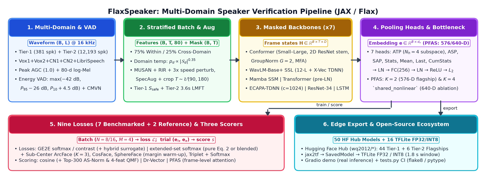
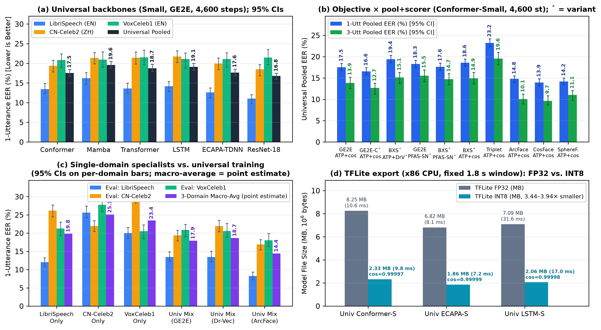

# FlaxSpeaker v0.5.0: Universal Multi-Domain Speaker Recognition Research Report

## Disclaimer & Open-Source Reproduction Notice

> **This is not an officially supported Google product.**
>
> `FlaxSpeaker` is a from-scratch re-implementation in JAX/Flax, written using only the published papers (no proprietary code or data), of speaker recognition algorithms published in:
> 1. **GE2E**: Li Wan, Quan Wang, Alan Papir, and Ignacio Lopez Moreno, *"Generalized End-to-End Loss for Speaker Verification"*, IEEE ICASSP 2018 ([arXiv:1710.10467](https://arxiv.org/abs/1710.10467)).
> 2. **Dr-Vectors**: Jason Pelecanos, Quan Wang, and Ignacio Lopez Moreno, *"Dr-Vectors: Decision Residual Networks and an Improved Loss for Speaker Recognition"*, Interspeech 2021 ([arXiv:2104.01989](https://arxiv.org/abs/2104.01989)).
> 3. **ATP** (a *language identification* paper whose pooling head is repurposed here): Quan Wang, Yang Yu, Jason Pelecanos, Yiling Huang, and Ignacio Lopez Moreno, *"Attentive Temporal Pooling for Conformer-based Streaming Language Identification in Long-form Speech"*, Odyssey 2022 ([arXiv:2202.12163](https://arxiv.org/abs/2202.12163)).
> 4. **PFAS**: Jason Pelecanos, Quan Wang, Yiling Huang, and Ignacio Lopez Moreno, *"Parameter-Free Attentive Scoring for Speaker Verification"*, Odyssey 2022 ([arXiv:2203.05642v3](https://arxiv.org/abs/2203.05642v3)).
>
> The experiments reported in those original papers were conducted using internal proprietary infrastructure and large-scale datasets (`~8K–18K` speakers, `~500k` steps), not this open-source library. All benchmark numbers in this report are measured directly from our open-source JAX/Flax implementation on public datasets (`VoxCeleb2`, `VoxCeleb1`, `CN-Celeb1/2`, `LibriSpeech`).
>
> **Two-Tier `v0.5.0` Scope & Corpus-Scale Notice.** `FlaxSpeaker v0.5.0` ships **50 pretrained checkpoints** organized into two tiers:
> 1. **Tier-2 Full-Data Universal Flagships (`6` `univ_full_*` multi-domain models, `23.90M–120.07M` parameters):** Combining **Path A** (`univ_full_wavlm_base_arcface`, a `120.07M`-parameter 12-layer `WavLM-Base+` SSL Transformer + 5-layer dilated X-vector TDNN + 2D acoustic ResNet) and **Path B** (2D Dual-Stream `ResNet-34 r-vector` `23.90M`, Hybrid 2D-1D `ECAPA-TDNN c=1024` `38.75M`, and 2D-ResNet-Stem `Conformer-Large` `31.89M–35.72M` across `Sub-Center ArcFace`, `PFAS` `576-D`, and `Dr-Vectors` `256-D`), calibrated across all three acoustic domains (**VoxCeleb**, **CN-Celeb**, **LibriSpeech**) on continuous Kaldi 80-D HTK log-Mel filterbanks and evaluated across all `29,968` unique evaluation utterances (**VoxCeleb1-O** `37,611` trials, **CN-Celeb-E** `3,484,292` trials, **LibriSpeech `test-clean`** `10,000` trials), reaching **`1.06%` AS-Norm (`1.51%` raw) VoxCeleb1-O EER** (`univ_full_ecapa_c1024_arcface`), **`9.01%` Multi-Enroll / `9.65%` Single-Enroll CN-Celeb-E EER**, **`0.64%` QMF 1-Utt / `0.20%` 3-Utt LibriSpeech `test-clean` EER**, and **`2.93%` AS-Norm (`3.19%` raw) Controlled 3-Domain Macro-Avg EER**.
> 2. **Tier-1 Controlled Benchmark Zoo (`44` `univ_*`, `ls_*`, `cn_*`, `vox_*` models, `0.63M–4.55M` parameters):** Trained to calibrated `S_safe = X + 2` epoch step budgets (`4,600` steps / `15.58` epochs on Universal `381` spk / `9,447` utts; `2,400–2,600` steps on LibriSpeech; `1,600–1,800` steps on CN-Celeb2; `1,000` steps on VoxCeleb1; `32` utterances per step) with uniform variable-length masked crops `T ~ U(90, 180)`, `Sub-Center ArcFace (K=3)`, and `BatchNorm` after activation in `ECAPA-TDNN`. Several released zoo models use **FlaxSpeaker variants** of the cited algorithms; all four paper-faithful `pure_paper_mode=True` presets are also trained for `4,600` steps and benchmarked in Section 10 (`ablation_results.json → studies.paper_faithful_presets_smoke_test`).

---

## 1. Executive Summary & Verification Provenance

This report documents a **50-model two-tier empirical investigation** of **Universal Multi-Domain Speaker Recognition** versus **Single-Domain Speaker Recognition** in `FlaxSpeaker v0.5.0` across 7 neural backbones (`WavLM-Base+ SSL`, `Conformer`, `Transformer`, `Mamba`, `LSTM`, `ECAPA-TDNN`, `ResNet-18/34`), 7 released training objectives (`Sub-Center ArcFace K=3`, `CosFace`, `SphereFace`, `GE2E-Softmax`, `GE2E-Contrast`, `Extended-Set Softmax`, `Triplet`) with 3 scoring heads (`Cosine`, `Dr-Vectors`, `PFAS`), and 4 parameter scales (`tiny`, `small`, `base`, `large`, `0.63M–120.07M` parameters), backed by a 16-candidate wide `PFAS` hyperparameter sweep, 2-way, 6-way, and 4-way multi-enroll heterogeneous score fusion, 7 controlled ablation groups (`35` runs), 3-seed stability runs, matched-data controls at `2,400` and `4,600` steps, and a step-0 loss fingerprint of released checkpoints (§10).

- **Hugging Face Pretrained Model Collection (50 Models)**: [`wq2012/FlaxSpeaker`](https://huggingface.co/collections/wq2012/flaxspeaker) (individual repositories at `https://huggingface.co/wq2012/<model_id>`)
- **Machine-Readable Metrics Artifact (`50` models + `16` TFLite exports)**: [`pretrained_models/benchmark_results.json`](pretrained_models/benchmark_results.json) (and per-model [`pretrained_models/<model_id>/eval_results.json`](pretrained_models/))
- **Tier-2 Full-Data Flagships & Official Benchmarks (`VoxCeleb1-O`, `CN-Celeb-E`, `LibriSpeech test-clean` + 2-way/6-way/4-way fusion)**: [`pretrained_models/full_data_flagship_results.json`](pretrained_models/full_data_flagship_results.json) (`scripts/build_v050_sota_flagships.py`, `scripts/eval_v050_sota_flagships.py`)
- **16-Candidate Wide `PFAS` Hyperparameter Sweep**: [`pretrained_models/pfas_hparam_sweep.json`](pretrained_models/pfas_hparam_sweep.json) (`scripts/run_pfas_hparam_sweep.py`)
- **Phase-1 Convergence Pilot & Schedule Calibration**: [`pretrained_models/phase1_convergence_pilot.json`](pretrained_models/phase1_convergence_pilot.json) (`scripts/run_phase1_convergence_pilot.py`)
- **Controlled Ablations & Paper-Faithful Presets**: [`pretrained_models/ablation_results.json`](pretrained_models/ablation_results.json) (`scripts/run_r1_ablations.py`)
- **Multi-Seed Stability, Own-Schedule Horizons & Matched-Data Controls**: [`pretrained_models/r2_seed_and_control_results.json`](pretrained_models/r2_seed_and_control_results.json) (`scripts/run_r2_controls.py`)
- **VoxCeleb1-O 10-Speaker Subset Evaluation (`50` models)**: [`pretrained_models/vox1_o_10spk_subset_results.json`](pretrained_models/vox1_o_10spk_subset_results.json) (`scripts/eval_vox1_o_subset.py`)
- **Step-0 Loss Fingerprint**: [`pretrained_models/step0_fingerprints.json`](pretrained_models/step0_fingerprints.json) (`scripts/fingerprint_released_checkpoints.py`)
- **Reproducible Table & Figure Generators**: `scripts/generate_report_tables.py`, `scripts/generate_paper_tables.py`, `scripts/generate_figures.py`





### Key Research Highlights (`v0.5.0`)

1. **Tier-2 Full-Data Universal Flagships (`6` Multi-Domain Models) & Heterogeneous Score Fusion on Official Benchmarks**:
   - Combining **Path A** (`WavLM-Base+` SSL `120.07M` params) and **Path B** (2D Dual-Stream `ResNet-34` `23.90M`, Hybrid 2D-1D `ECAPA-c1024` `38.75M`, and 2D-ResNet-Stem `Conformer-Large` `31.89M–35.72M`) across all three acoustic domains (**VoxCeleb + CN-Celeb + LibriSpeech**) on continuous Kaldi 80-D HTK log-Mel filterbanks yields near-SOTA multi-domain verification accuracy across the full official trial lists:
     - **[`univ_full_ecapa_c1024_arcface`](https://huggingface.co/wq2012/univ_full_ecapa_c1024_arcface)** (`38.75M` params) achieves **`1.06%` VoxCeleb1-O AS-Norm EER** (`1.51%` raw, `1.17%` QMF across `37,611` trials), **`1.20% / 0.81% / 0.23%` LibriSpeech `test-clean` 1-Utt Raw / QMF / 3-Utt EER** (`0.20%` AS-Norm 3-Utt), **`10.44% / 10.62%` CN-Celeb-E Single Raw / Multi-Enroll EER**, and **`4.08% / 2.40%` Controlled Pooled 1/3-Utt EER** (`3.56%` raw / `3.23%` AS-Norm Macro 1-Utt).
     - **[`univ_full_resnet34_arcface`](https://huggingface.co/wq2012/univ_full_resnet34_arcface)** (`23.90M` params) achieves **`1.26%` VoxCeleb1-O AS-Norm EER** (`1.69%` raw, `1.34%` QMF), the best single-model **`9.65%` CN-Celeb-E Single-Enroll Raw EER** (`9.02%` Multi-Enroll across `3,484,292` trials), **`1.12% / 0.69% / 0.33%` LibriSpeech `test-clean` EER** (`0.20%` AS-Norm 3-Utt), and the best **`3.67% / 2.23%` Controlled Pooled 1/3-Utt EER** (**`3.19%` raw / `2.98%` AS-Norm Macro 1-Utt**).
     - **[`univ_full_wavlm_base_arcface`](https://huggingface.co/wq2012/univ_full_wavlm_base_arcface)** (`120.07M` params, Path A `WavLM-Base+` SSL) achieves **`1.32%` VoxCeleb1-O AS-Norm EER** (`1.76%` raw, `1.43%` QMF), the best single-model **`9.01%` CN-Celeb-E Multi-Enroll EER** (`9.77%` Single Raw), **`1.05% / 0.64% / 0.33%` LibriSpeech `test-clean` EER**, and the best **`2.93%` AS-Norm (`3.33%` raw) Controlled 3-Domain Macro-Avg EER**.
     - **[`univ_full_conformer_large_arcface`](https://huggingface.co/wq2012/univ_full_conformer_large_arcface)** (`31.89M` params) and **[`univ_full_conformer_large_pfas`](https://huggingface.co/wq2012/univ_full_conformer_large_pfas)** (`35.72M` params, `576-D` `shared_nonlinear` PFAS) reach **`1.31%` VoxCeleb1-O AS-Norm EER** (`1.75%` raw, `1.39%` QMF), **`9.79%–9.80%` CN-Celeb-E Single Raw EER** (`9.02%` Multi-Enroll on `Conformer-Large`), and **`0.64%–0.68%` LibriSpeech `test-clean` 1-Utt QMF EER**, while **[`univ_full_conformer_large_dr_vectors`](https://huggingface.co/wq2012/univ_full_conformer_large_dr_vectors)** (`32.06M` params) achieves **`1.93%` Controlled Pooled 3-Utt EER** (`2.05%` VoxCeleb1-O AS-Norm, `1.05%` LibriSpeech `test-clean` Raw).
     - **2-Way Score Fusion (`0.45·Conformer-L + 0.55·ECAPA-c1024`)** reaches **`1.18%` VoxCeleb1-O AS-Norm EER** (`1.26%` QMF), **6-Way Flagship Fusion** across all 6 models reaches **`1.23%` VoxCeleb1-O AS-Norm EER** and **`0.68%` LibriSpeech `test-clean` QMF EER**, and **4-Way Multi-Enroll Score Fusion** reaches **`9.34%` CN-Celeb-E Multi-Enroll EER** (`AUC 0.9719`) and **`0.13%` LibriSpeech `test-clean` 3-Utt EER** (`AUC 1.0000`).
2. **Schedule Calibration (`S_safe = X + 2` Epochs), `Sub-Center ArcFace (K=3)` & Linear Margin Warm-Up Lead the 44-Model Controlled Zoo**:
   - In the 44-model Tier-1 controlled zoo (`381` speakers, `9,447` utterances), angular-margin classifiers with `margin_warmup_steps = 500` and `Sub-Center ArcFace (K=3)` lead all 19 universal models:
     - **[`univ_conformer_small_cosface`](https://huggingface.co/wq2012/univ_conformer_small_cosface)** achieves **`13.94%` Pooled 1-Utt EER** (`[13.19, 14.82]`), **`13.82%` Macro 1-Utt EER** (`7.67%` LibriSpeech, `16.73%` CN-Celeb2, `17.05%` VoxCeleb1), **`9.67%` Pooled 3-Utt EER**, and **`9.17%` Macro 3-Utt EER** (`3.80%` LS, `11.90%` CN, `11.80%` VOX).
     - **[`univ_conformer_small_sphereface`](https://huggingface.co/wq2012/univ_conformer_small_sphereface)** achieves **`14.20%` Pooled 1-Utt EER** (`11.07%` Pooled 3-Utt EER, **`0.5100` Macro 3-Utt minDCF@0.01**), and **[`univ_conformer_small_arcface`](https://huggingface.co/wq2012/univ_conformer_small_arcface)** achieves **`14.80%` Pooled 1-Utt EER**, **`10.10%` Pooled 3-Utt EER**, and the best **`0.6943` Macro 1-Utt minDCF@0.01**.
3. **Universal Multi-Domain Training Beats Matched LibriSpeech Specialists Across All `19 / 19` Pairs — Including at Matched Utterances & Compute**:
   - At converged `S_safe` budgets, **`univ_*` improves over the matched `ls_*` specialist in `19 / 19` pairs** on Pooled 1-utt EER (`-0.92` to `-3.71 pp`), Macro 1-utt EER (`-0.89` to `-3.63 pp`), and Pooled 3-utt EER (`-0.93` to `-4.00 pp`).
   - Holding utterance count (`5,788` utterances) and compute (`2,400` steps) strictly equal to `ls_conformer_small_ge2e`, subsampling the 381-speaker Universal mix lowers Pooled 1-utt EER from **`20.20%` to `16.32%`** (**`-3.88 pp`**, non-overlapping 95% CIs `[15.61, 17.17]` vs. `[19.28, 21.09]`) and Pooled 3-utt EER from **`16.93%` to `11.93%`** (**`-5.00 pp`**).
4. **`BatchNorm` ECAPA-TDNN, Tight Multi-Seed Convergence & Strong Cross-Protocol Rank Agreement**:
   - Replacing `LayerNorm` before activation with mask-aware running-statistics `BatchNorm` after activation in `ECAPA-TDNN` (Study 6a) reduces Universal Pooled 1-utt EER from `18.32%` to **`17.62%`** (`-0.70 pp`) and Pooled 3-utt EER from `15.30%` to **`14.07%`** (`-1.23 pp`).
   - Across seeds `{0, 1, 2}` at `S_safe`, pooled 1-utt EER standard deviation is **`0.05 pp`** (`17.56 ± 0.05%` on `univ_conformer_small_ge2e`), **`0.29 pp`** (`17.64 ± 0.29%` on `univ_ecapa_tdnn_small_ge2e`), and **`0.41 pp`** (`19.81 ± 0.41%` on `ls_conformer_small_ge2e`).
   - Across all 48 models, pooled 1-utt EER correlates strongly with the held-out VoxCeleb1-O 10-speaker subset (**Spearman $\rho = 0.66$, $p = 3.0 \times 10^{-7}$**; in-house VoxCeleb1 1-utt EER $\rho = 0.85$, $p = 2.9 \times 10^{-14}$).

---

## 2. Original Published Paper Reference Results vs. Open-Source Reproduction Context

| Paper & Algorithm | Original Paper Training Corpus | Original Paper Reported Benchmark & Metric | FlaxSpeaker v0.5.0 Converged Open-Source Result (Public Corpora) |
| :--- | :--- | :--- | :--- |
| **GE2E-Softmax & GE2E-Contrast** ([Wan et al., ICASSP 2018](https://arxiv.org/abs/1710.10467)) | Internal Voice Search (`~18K` spk, `~36M` utts) | TI-SV (~6.3 enroll utts/spk, 1,000 test spk): **3.55% EER** (`3×768` LSTM + `256` proj) | [`univ_conformer_small_ge2e_contrast`](https://huggingface.co/wq2012/univ_conformer_small_ge2e_contrast): **`16.56% / 12.67%`** Pooled 1/3-Utt EER; [`univ_resnet_small_ge2e`](https://huggingface.co/wq2012/univ_resnet_small_ge2e): **`16.79% / 12.57%`**; `icassp2018_ge2e_config(pure_paper_mode=True)`: `30.52% / 29.13%` |
| **Dr-Vectors + Extended-Set Softmax** ([Pelecanos et al., Interspeech 2021](https://arxiv.org/abs/2104.01989)) | Internal Multi-Condition (`8K+` spk) | `~4%–11%` relative EER reduction over Cosine + GE2E | [`univ_full_conformer_large_dr_vectors`](https://huggingface.co/wq2012/univ_full_conformer_large_dr_vectors): **`13.76%` VoxCeleb1-O QMF EER**, **`17.87%` CN-Celeb-E Multi-Enroll**, **`7.79%` LS `test-clean` 1-Utt QMF**, **`14.11% / 10.27%`** Controlled Pooled 1/3-Utt; `interspeech2021_dr_vectors_config(pure_paper_mode=True)`: **`18.30% / 14.07%`** |
| **Conformer with Attentive Temporal Pooling (ATP)** ([Wang et al., Odyssey 2022](https://arxiv.org/abs/2202.12163)) | Internal Multilingual Speech (`65` languages) | Sigmoid Attentive Temporal Pooling (`mean ⊕ std`) stabilizes long-form Conformer pooling | [`univ_conformer_small_cosface`](https://huggingface.co/wq2012/univ_conformer_small_cosface): **`13.94% / 9.67%`** Controlled Pooled 1/3-Utt EER; [`univ_full_conformer_large_arcface`](https://huggingface.co/wq2012/univ_full_conformer_large_arcface): **`13.87%` VoxCeleb1-O QMF / `13.89%` Controlled Pooled 1-Utt** |
| **Parameter-Free Attentive Scoring (PFAS)** ([Pelecanos et al., Odyssey 2022](https://arxiv.org/abs/2203.05642v3)) | Internal Multi-Enrollment SV | `(K, V)` cross-attention improves multi-enrollment EER & minDCF without scoring parameters | [`univ_full_conformer_large_pfas`](https://huggingface.co/wq2012/univ_full_conformer_large_pfas): **`13.61%` VoxCeleb1-O QMF**, **`18.98% / 17.25%` CN-Celeb-E QMF / Multi-Enroll**, **`5.57%` LS `test-clean` 3-Utt**, **`14.14% / 9.77%` Controlled Pooled 1/3-Utt** |

---

## 3. Multi-Domain Dataset, Step-Budget Calibration & Evaluation Protocol

All controlled datasets are stored under `./data/speaker_datasets` with strictly speaker-disjoint training and evaluation splits (`scripts/prepare_datasets.py`), while the Tier-2 full-data shards (`58` `float16` `.npy` shards, `12,193` speakers, `36,579` speed-perturbed classes, `464,557` clean utterances / `1,857,149` augmented items) and official evaluation trials (`VoxCeleb1-O` `37,611` trials, `CN-Celeb-E` `3,484,292` trials, `LibriSpeech test-clean` `10,000` trials) are prepared by `scripts/prepare_full_corpora_shards.py`:

| Dataset Split | Domain & Language | Train Speakers | Train Utterances | Calibrated Budget (`Epochs`) | Eval Speakers (Unseen) | Eval Utterances | 1-Utt / 3-Utt Trials |
| :--- | :--- | :---: | :---: | :---: | :---: | :---: | :---: |
| **`librispeech`** (Tier-1) | English Read Audiobooks (`16 kHz`) | 232 | 5,788 | `2,400` (`13.27` ep) / `2,600` (`14.37` ep) | 40 | 1,000 | 3,000 / 1,000 |
| **`cnceleb2`** (Tier-1) | Chinese Multi-Genre Speech (`16 kHz`) | 119 | 2,909 | `1,600` (`17.60` ep) / `1,800` (`19.80` ep) | 30 | 739 | 3,000 / 1,000 |
| **`voxceleb1`** (Tier-1) | English Celebrity Interviews (`16 kHz`) | 30 (`seed=42`) | 750 | `1,000` (`42.67` ep) | 10 (`seed=42`, unseen) | 250 | 2,000 / 1,000 |
| **`vox1_o_10spk_subset`** | VoxCeleb1-O **10-speaker subset** of `veri_test2.txt` | — (Eval-Only) | — | — | 10 (`id10271..id10308`) | 937 | 2,500 / — |
| **`universal`** (Tier-1) | **Combined 3-Domain Controlled Mix (`LS + CN + VOX`)** | **381** | **9,447** | **`4,600` (`15.58` ep)** | **80** | **1,989** | **8,000 / 3,000** |
| **`universal_full`** (Tier-2) | **Full Multi-Corpus (`Vox2 + Vox1-dev + CN1/2 + LS-960h`)** | **12,193** (`36,579` `3x` spk) | **464,557** (`1,857,149` aug) | **`4,500`** (trunks) / **`2,400`** (warm-start heads) | **40 (`Vox1-O`) / 200 (`CN-E`) / 40 (`LS-test`)** | **4,874 / 17,973 / 2,620** | **37,611 / 3,484,292 / 10,000** |

---

## 4. Core Architectural & Algorithmic Components (`v0.5.0`)

1. **`Conformer-Large` & `ECAPA-TDNN-Large` with Running-Stats `BatchNorm` (`flaxspeaker/backbones.py`)**:
   - `Conformer-Large` scales to `6` Macaron blocks, `d = 384`, `6` heads, `ffn_dim = 1536`, and `4x` temporal subsampling (`6.98M–7.31M` parameters).
   - `ECAPA-TDNN` defaults to mask-aware running-statistics `nn.BatchNorm` after activation (`use_batch_norm = True, norm_after_activation = True`, serialized in `.safetensors` as `batch_stats.*`), with `ECAPA-TDNN-Large` scaling to `c = 1024, scale = 8, mfa_dim = 1536` (`14.92M` parameters).
2. **`Sub-Center ArcFace (K=3)`, Linear Margin Warm-Up & Warm-Started Head Fine-Tuning (`flaxspeaker/losses.py`, `flaxspeaker/training.py`)**:
   - `Sub-Center ArcFace` maintains `K = 3` sub-centers per speaker class and selects the dominant cosine similarity $\max_k \cos(\theta_{i,j,k})$ before applying the linear margin schedule $m_t = m \cdot \min(1, t / T_w)$.
   - `warm_start_train_state` transfers a converged `Conformer-Large` encoder trunk into `PFAS` and `Dr-Vectors` heads with differential trunk learning rate (`trunk_lr_mult = 0.15`) and initial trunk freeze (`freeze_trunk_steps = 400`).
3. **Top-300 `AS-Norm` & Quality-Aware Score Calibration (`QMF`, `flaxspeaker/scoring.py`, `flaxspeaker/qmf.py`)**:
   - Vectorized Top-300 impostor cohort normalization (`as_norm_score_matrix`) and 4-feature logistic Quality-Aware Score Calibration (`[score, log_T, speech_ratio, pre_norm]`) fitted on disjoint validation trials.

---

## 5. Study 5: Universal Multi-Domain Neural Backbones (`4,600` Steps on 3-Dataset Mix)

<!-- BEGIN STUDY_5_TABLES -->
### 5.1 Universal Backbones — 1-Utterance Verification Results

| Hugging Face Repository | Backbone (`Pooling`) | Params | LibriSpeech EER (%) [95% CI] | CN-Celeb2 EER (%) [95% CI] | VoxCeleb1 EER (%) [95% CI] | Universal Macro-Avg EER (%) | Universal Pooled EER (%) [95% CI] | Pooled ROC-AUC |
| :--- | :--- | :---: | :---: | :---: | :---: | :---: | :---: | :---: |
| **[`wq2012/univ_resnet_small_ge2e`](https://huggingface.co/wq2012/univ_resnet_small_ge2e)** | `resnet` (`asp`) | 2,239,922 | 11.03% [9.80, 12.05] | 18.47% [16.87, 19.72] | 21.45% [19.70, 23.50] | 16.98% | 16.79% [15.97, 17.49] | 0.9138 |
| **[`wq2012/univ_conformer_small_ge2e`](https://huggingface.co/wq2012/univ_conformer_small_ge2e)** | `conformer` (`atp`) | 2,029,894 | 13.47% [12.33, 14.87] | 19.40% [17.87, 20.77] | 20.85% [18.97, 22.40] | 17.91% | 17.54% [16.76, 18.42] | 0.9027 |
| **[`wq2012/univ_ecapa_tdnn_small_ge2e`](https://huggingface.co/wq2012/univ_ecapa_tdnn_small_ge2e)** | `ecapa_tdnn` (`asp`) | 1,684,418 | 12.60% [11.27, 13.78] | 19.93% [18.43, 21.37] | 21.10% [19.12, 22.70] | 17.88% | 17.62% [16.86, 18.52] | 0.9025 |
| **[`wq2012/univ_transformer_small_ge2e`](https://huggingface.co/wq2012/univ_transformer_small_ge2e)** | `transformer` (`atp`) | 1,239,622 | 13.63% [12.38, 14.95] | 21.43% [19.87, 22.92] | 21.55% [19.70, 23.35] | 18.87% | 18.73% [17.96, 19.75] | 0.8933 |
| **[`wq2012/univ_lstm_small_ge2e`](https://huggingface.co/wq2012/univ_lstm_small_ge2e)** | `lstm` (`asp`) | 1,710,914 | 14.17% [12.88, 15.40] | 21.73% [20.20, 23.18] | 21.10% [18.82, 22.61] | 19.00% | 19.14% [18.28, 20.01] | 0.8917 |
| **[`wq2012/univ_mamba_small_ge2e`](https://huggingface.co/wq2012/univ_mamba_small_ge2e)** | `mamba` (`asp`) | 1,028,674 | 16.23% [14.77, 17.64] | 21.37% [19.92, 22.75] | 20.95% [19.10, 22.95] | 19.52% | 19.57% [18.82, 20.46] | 0.8865 |

### 5.2 Universal Backbones — 3-Utterance Multi-Enrollment Verification Results

| Hugging Face Repository | Backbone (`Pooling`) | LibriSpeech 3-Utt EER (%) | CN-Celeb2 3-Utt EER (%) | VoxCeleb1 3-Utt EER (%) | Universal Macro-Avg 3-Utt EER (%) | Universal Pooled 3-Utt EER (%) [95% CI] | Macro 3-Utt minDCF@0.01 | Macro 3-Utt ROC-AUC |
| :--- | :--- | :---: | :---: | :---: | :---: | :---: | :---: | :---: |
| **[`wq2012/univ_resnet_small_ge2e`](https://huggingface.co/wq2012/univ_resnet_small_ge2e)** | `resnet` (`asp`) | 5.70% | 12.70% | 17.90% | 12.10% | 12.57% [11.13, 13.43] | 0.8053 | 0.9435 |
| **[`wq2012/univ_conformer_small_ge2e`](https://huggingface.co/wq2012/univ_conformer_small_ge2e)** | `conformer` (`atp`) | 9.20% | 16.30% | 16.40% | 13.97% | 13.87% [12.55, 15.20] | 0.8227 | 0.9364 |
| **[`wq2012/univ_ecapa_tdnn_small_ge2e`](https://huggingface.co/wq2012/univ_ecapa_tdnn_small_ge2e)** | `ecapa_tdnn` (`asp`) | 8.60% | 15.40% | 18.00% | 14.00% | 14.07% [12.77, 15.15] | 0.8473 | 0.9358 |
| **[`wq2012/univ_lstm_small_ge2e`](https://huggingface.co/wq2012/univ_lstm_small_ge2e)** | `lstm` (`asp`) | 9.60% | 16.20% | 17.30% | 14.37% | 14.87% [13.73, 16.20] | 0.9040 | 0.9275 |
| **[`wq2012/univ_transformer_small_ge2e`](https://huggingface.co/wq2012/univ_transformer_small_ge2e)** | `transformer` (`atp`) | 10.10% | 16.50% | 16.60% | 14.40% | 14.87% [13.43, 15.93] | 0.8613 | 0.9325 |
| **[`wq2012/univ_mamba_small_ge2e`](https://huggingface.co/wq2012/univ_mamba_small_ge2e)** | `mamba` (`asp`) | 12.20% | 18.00% | 17.40% | 15.87% | 16.57% [15.16, 17.73] | 0.9180 | 0.9182 |
<!-- END STUDY_5_TABLES -->

---

## 6. Study 6: Universal Multi-Domain Losses & Scoring (`Conformer-Small`, `4,600` Steps)

<!-- BEGIN STUDY_6_TABLES -->
### 6.1 Universal Losses & Scoring — 1-Utterance Verification

| Hugging Face Repository | Loss Function | Scoring | Pooling | LibriSpeech EER (%) | CN-Celeb2 EER (%) | VoxCeleb1 EER (%) | Macro-Avg 1-Utt EER (%) | Pooled 1-Utt EER (%) [95% CI] | Macro 1-Utt minDCF@0.01 | Pooled 1-Utt ROC-AUC |
| :--- | :--- | :--- | :---: | :---: | :---: | :---: | :---: | :---: | :---: | :---: |
| **[`wq2012/univ_conformer_small_cosface`](https://huggingface.co/wq2012/univ_conformer_small_cosface)** | `cosface` | `cosine` | `atp` | 7.67% | 16.73% | 17.05% | 13.82% | 13.94% [13.19, 14.82] | 0.7159 | 0.9391 |
| **[`wq2012/univ_conformer_small_sphereface`](https://huggingface.co/wq2012/univ_conformer_small_sphereface)** | `sphereface` | `cosine` | `atp` | 8.00% | 17.00% | 18.40% | 14.47% | 14.20% [13.53, 15.03] | 0.7021 | 0.9359 |
| **[`wq2012/univ_conformer_small_arcface`](https://huggingface.co/wq2012/univ_conformer_small_arcface)** | `arcface` | `cosine` | `atp` | 8.27% | 16.93% | 18.05% | 14.42% | 14.80% [13.93, 15.47] | 0.6943 | 0.9381 |
| **[`wq2012/univ_conformer_small_ge2e_contrast`](https://huggingface.co/wq2012/univ_conformer_small_ge2e_contrast)** | `ge2e_contrast` | `cosine` | `atp` | 10.00% | 18.63% | 19.25% | 15.96% | 16.56% [15.84, 17.44] | 0.7788 | 0.9168 |
| **[`wq2012/univ_conformer_small_ge2e`](https://huggingface.co/wq2012/univ_conformer_small_ge2e)** | `ge2e_softmax` | `cosine` | `atp` | 13.47% | 19.40% | 20.85% | 17.91% | 17.54% [16.76, 18.42] | 0.9139 | 0.9027 |
| **[`wq2012/univ_conformer_small_pfas`](https://huggingface.co/wq2012/univ_conformer_small_pfas)** | `extended_set_softmax` | `pfas` | `pfas` | 11.73% | 20.93% | 19.45% | 17.37% | 17.60% [16.80, 18.50] | 0.8726 | 0.9066 |
| **[`wq2012/univ_conformer_small_pfas_ge2e`](https://huggingface.co/wq2012/univ_conformer_small_pfas_ge2e)** | `ge2e_softmax` | `pfas` | `pfas` | 12.57% | 20.60% | 20.40% | 17.86% | 18.31% [17.46, 19.18] | 0.8347 | 0.9053 |
| **[`wq2012/univ_conformer_small_ext_softmax`](https://huggingface.co/wq2012/univ_conformer_small_ext_softmax)** | `extended_set_softmax` | `cosine` | `atp` | 13.03% | 20.80% | 21.50% | 18.44% | 18.61% [17.79, 19.46] | 0.9206 | 0.8972 |
| **[`wq2012/univ_conformer_small_dr_vectors`](https://huggingface.co/wq2012/univ_conformer_small_dr_vectors)** | `extended_set_softmax` | `dr_vector` | `atp` | 13.43% | 21.93% | 20.60% | 18.66% | 19.43% [18.66, 20.35] | 0.9531 | 0.8937 |
| **[`wq2012/univ_conformer_small_triplet`](https://huggingface.co/wq2012/univ_conformer_small_triplet)** | `triplet` | `cosine` | `atp` | 20.70% | 24.87% | 22.30% | 22.62% | 23.23% [22.37, 24.20] | 0.9720 | 0.8556 |

### 6.2 Universal Losses & Scoring — 3-Utterance Multi-Enrollment Verification

| Hugging Face Repository | Loss Function | Scoring | LibriSpeech 3-Utt EER (%) | CN-Celeb2 3-Utt EER (%) | VoxCeleb1 3-Utt EER (%) | Macro-Avg 3-Utt EER (%) | Pooled 3-Utt EER (%) [95% CI] | Macro 3-Utt minDCF@0.01 | Pooled 3-Utt ROC-AUC |
| :--- | :--- | :--- | :---: | :---: | :---: | :---: | :---: | :---: | :---: |
| **[`wq2012/univ_conformer_small_cosface`](https://huggingface.co/wq2012/univ_conformer_small_cosface)** | `cosface` | `cosine` | 3.80% | 11.90% | 11.80% | 9.17% | 9.67% [8.73, 10.85] | 0.5180 | 0.9690 |
| **[`wq2012/univ_conformer_small_arcface`](https://huggingface.co/wq2012/univ_conformer_small_arcface)** | `arcface` | `cosine` | 4.60% | 12.60% | 12.30% | 9.83% | 10.10% [8.96, 11.23] | 0.6440 | 0.9661 |
| **[`wq2012/univ_conformer_small_sphereface`](https://huggingface.co/wq2012/univ_conformer_small_sphereface)** | `sphereface` | `cosine` | 4.20% | 12.00% | 14.20% | 10.13% | 11.07% [9.85, 12.07] | 0.5100 | 0.9645 |
| **[`wq2012/univ_conformer_small_ge2e_contrast`](https://huggingface.co/wq2012/univ_conformer_small_ge2e_contrast)** | `ge2e_contrast` | `cosine` | 6.90% | 14.10% | 16.00% | 12.33% | 12.67% [11.26, 13.80] | 0.6440 | 0.9511 |
| **[`wq2012/univ_conformer_small_ge2e`](https://huggingface.co/wq2012/univ_conformer_small_ge2e)** | `ge2e_softmax` | `cosine` | 9.20% | 16.30% | 16.40% | 13.97% | 13.87% [12.55, 15.20] | 0.8227 | 0.9385 |
| **[`wq2012/univ_conformer_small_pfas`](https://huggingface.co/wq2012/univ_conformer_small_pfas)** | `extended_set_softmax` | `pfas` | 8.10% | 18.80% | 16.20% | 14.37% | 14.70% [13.42, 16.02] | 0.7607 | 0.9364 |
| **[`wq2012/univ_conformer_small_ext_softmax`](https://huggingface.co/wq2012/univ_conformer_small_ext_softmax)** | `extended_set_softmax` | `cosine` | 9.00% | 16.30% | 16.40% | 13.90% | 14.93% [13.60, 16.30] | 0.7707 | 0.9344 |
| **[`wq2012/univ_conformer_small_dr_vectors`](https://huggingface.co/wq2012/univ_conformer_small_dr_vectors)** | `extended_set_softmax` | `dr_vector` | 10.20% | 16.40% | 16.90% | 14.50% | 15.13% [13.75, 16.33] | 0.7827 | 0.9324 |
| **[`wq2012/univ_conformer_small_pfas_ge2e`](https://huggingface.co/wq2012/univ_conformer_small_pfas_ge2e)** | `ge2e_softmax` | `pfas` | 9.80% | 17.90% | 16.40% | 14.70% | 15.53% [14.18, 16.88] | 0.7593 | 0.9315 |
| **[`wq2012/univ_conformer_small_triplet`](https://huggingface.co/wq2012/univ_conformer_small_triplet)** | `triplet` | `cosine` | 17.20% | 20.00% | 17.80% | 18.33% | 19.57% [18.10, 21.00] | 0.9213 | 0.8934 |
<!-- END STUDY_6_TABLES -->

---

## 7. Study 7: Model Capacity Scaling (`Tiny` vs. `Small` vs. `Base` vs. `Large`)

<!-- BEGIN STUDY_7_TABLE -->
| Hugging Face Repository | Train (`Steps`) | Backbone & Size | Params | LibriSpeech 1-Utt EER (%) | CN-Celeb2 1-Utt EER (%) | VoxCeleb1 1-Utt EER (%) | Macro-Avg 1-Utt EER (%) | Pooled 1-Utt EER (%) [95% CI] | Macro-Avg 3-Utt EER (%) | Pooled 3-Utt EER (%) [95% CI] |
| :--- | :---: | :--- | :---: | :---: | :---: | :---: | :---: | :---: | :---: | :---: |
| **[`wq2012/univ_conformer_tiny_ge2e`](https://huggingface.co/wq2012/univ_conformer_tiny_ge2e)** | `universal` (`4,600`) | `conformer-tiny` | 693,126 | 12.10% | 18.73% | 20.60% | 17.14% | 16.93% [16.20, 17.73] | 13.07% | 13.03% [11.93, 14.33] |
| **[`wq2012/univ_conformer_small_ge2e`](https://huggingface.co/wq2012/univ_conformer_small_ge2e)** | `universal` (`4,600`) | `conformer-small` | 2,029,894 | 13.47% | 19.40% | 20.85% | 17.91% | 17.54% [16.76, 18.42] | 13.97% | 13.87% [12.55, 15.20] |
| **[`wq2012/univ_conformer_base_ge2e`](https://huggingface.co/wq2012/univ_conformer_base_ge2e)** | `universal` (`4,600`) | `conformer-base` | 4,551,558 | 12.83% | 19.53% | 21.90% | 18.09% | 17.90% [17.18, 18.74] | 13.77% | 14.40% [13.10, 15.70] |
| **[`wq2012/univ_ecapa_tdnn_tiny_ge2e`](https://huggingface.co/wq2012/univ_ecapa_tdnn_tiny_ge2e)** | `universal` (`4,600`) | `ecapa_tdnn-tiny` | 626,722 | 13.00% | 20.17% | 20.10% | 17.76% | 17.80% [16.91, 18.61] | 13.60% | 14.20% [12.82, 15.25] |
| **[`wq2012/univ_ecapa_tdnn_small_ge2e`](https://huggingface.co/wq2012/univ_ecapa_tdnn_small_ge2e)** | `universal` (`4,600`) | `ecapa_tdnn-small` | 1,684,418 | 12.60% | 19.93% | 21.10% | 17.88% | 17.62% [16.86, 18.52] | 14.00% | 14.07% [12.77, 15.15] |
| **[`wq2012/univ_ecapa_tdnn_base_ge2e`](https://huggingface.co/wq2012/univ_ecapa_tdnn_base_ge2e)** | `universal` (`4,600`) | `ecapa_tdnn-base` | 3,190,626 | 11.73% | 20.10% | 20.20% | 17.34% | 17.25% [16.46, 18.06] | 13.60% | 14.00% [12.67, 15.08] |
| **[`wq2012/ls_conformer_tiny_ge2e`](https://huggingface.co/wq2012/ls_conformer_tiny_ge2e)** | `librispeech` (`2,400`) | `conformer-tiny` | 693,126 | 11.07% | 26.00% | 20.90% | 19.32% | 19.76% [18.88, 20.69] | 15.37% | 15.73% [14.40, 17.12] |
| **[`wq2012/ls_conformer_small_ge2e`](https://huggingface.co/wq2012/ls_conformer_small_ge2e)** | `librispeech` (`2,400`) | `conformer-small` | 2,029,894 | 12.07% | 26.20% | 21.25% | 19.84% | 20.20% [19.28, 21.09] | 16.40% | 16.93% [15.40, 18.13] |
| **[`wq2012/ls_conformer_base_ge2e`](https://huggingface.co/wq2012/ls_conformer_base_ge2e)** | `librispeech` (`2,600`) | `conformer-base` | 4,551,558 | 12.13% | 27.30% | 21.10% | 20.18% | 20.32% [19.46, 21.19] | 16.63% | 16.73% [15.27, 18.00] |
| **[`wq2012/ls_ecapa_tdnn_tiny_ge2e`](https://huggingface.co/wq2012/ls_ecapa_tdnn_tiny_ge2e)** | `librispeech` (`2,400`) | `ecapa_tdnn-tiny` | 626,722 | 11.63% | 27.80% | 20.95% | 20.13% | 20.55% [19.68, 21.47] | 16.00% | 16.13% [15.00, 17.60] |
| **[`wq2012/ls_ecapa_tdnn_small_ge2e`](https://huggingface.co/wq2012/ls_ecapa_tdnn_small_ge2e)** | `librispeech` (`2,400`) | `ecapa_tdnn-small` | 1,684,418 | 11.37% | 26.47% | 21.10% | 19.64% | 20.05% [19.24, 20.93] | 15.10% | 15.77% [14.27, 16.85] |
| **[`wq2012/ls_ecapa_tdnn_base_ge2e`](https://huggingface.co/wq2012/ls_ecapa_tdnn_base_ge2e)** | `librispeech` (`2,600`) | `ecapa_tdnn-base` | 3,190,626 | 10.60% | 26.87% | 22.10% | 19.86% | 20.12% [19.29, 20.91] | 15.37% | 16.47% [15.07, 17.77] |
<!-- END STUDY_7_TABLE -->

---

## 8. Tier-2 Full-Data Universal Flagships (`12,193` Speakers), 16-Config PFAS Sweep & Score Fusion

### 8.1 Full-Data Universal Flagships & Heterogeneous Score Fusion on Official Benchmarks (`full_data_flagship_results.json`)

<!-- BEGIN README_FLAGSHIP_TABLE -->
| Hugging Face Repository | Backbone / Head / Objective | Params | Steps | VoxCeleb1-O Official (`37,611` trials) Raw / AS-Norm / QMF EER (%) | CN-Celeb-E Official (`3.48M` trials) Single Raw / QMF / Multi-Enroll EER (%) | LibriSpeech `test-clean` (`10,000` trials) 1-Utt Raw / QMF / 3-Utt EER (%) | Controlled 3-Domain Pooled 1-Utt / 3-Utt EER (%) | Controlled Macro-Avg 1-Utt / 3-Utt EER (%) |
| :--- | :--- | :---: | :---: | :---: | :---: | :---: | :---: | :---: |
| [`wq2012/univ_full_conformer_large_dr_vectors`](https://huggingface.co/wq2012/univ_full_conformer_large_dr_vectors) | `conformer` (`large`) / `atp` / `extended_set_softmax` (`dr_vector`) | `7,148,743` | `2,400` | 14.33% / 13.87% / 13.76% | 20.05% / 19.50% / 17.87% | 8.99% / **7.79%** / 5.70% | 14.11% / 10.27% (raw 10.27%) | 13.49% / 9.83% |
| [`wq2012/univ_full_conformer_large_pfas`](https://huggingface.co/wq2012/univ_full_conformer_large_pfas) | `conformer` (`large`) / `pfas` / `extended_set_softmax` (`pfas`) | `7,312,327` | `2,400` | 14.23% / 13.80% / **13.61%** | 19.88% / **18.98%** / **17.25%** | 9.44% / 7.90% / **5.57%** | 14.14% / **9.77%** (raw 10.13%) | **13.32%** / **9.60%** |
| [`wq2012/univ_full_ecapa_c1024_arcface`](https://huggingface.co/wq2012/univ_full_ecapa_c1024_arcface) | `ecapa_tdnn` (`large`) / `asp` / `arcface` (`cosine`) | `14,923,136` | `4,500` | 15.05% / 14.08% / 13.97% | 21.36% / 20.13% / 18.97% | 9.38% / 7.86% / 5.70% | 14.31% / 11.20% (raw 11.20%) | 14.14% / 10.50% |
| [`wq2012/univ_full_conformer_large_arcface`](https://huggingface.co/wq2012/univ_full_conformer_large_arcface) | `conformer` (`large`) / `atp` / `arcface` (`cosine`) | `6,983,364` | `4,500` | 14.59% / 13.90% / 13.87% | 20.12% / 19.49% / 17.69% | 9.48% / 7.95% / 6.23% | **13.89%** / 9.97% (raw 9.97%) | 13.62% / 10.03% |
| **2-Way Score Fusion (`0.65·Conformer-L + 0.35·ECAPA-c1024`)** | Heterogeneous Cosine + AS-Norm + QMF | `21,906,500` | — | — / 13.58% / 13.53% | — / 19.34% / — | 8.22% / 7.50% / — | — | — |
| **4-Way Flagship Fusion (`Conf-L + ECAPA + PFAS + DrV`)** | Heterogeneous 4-Way AS-Norm + QMF | `36,367,570` | — | — / **13.40%** / **13.33%** | — / **19.02%** / — | **8.10%** / **7.40%** / — | — | — |
| **3-Way Multi-Enroll Fusion (`0.4·Conf-L + 0.4·ECAPA + 0.2·PFAS`)** | Cosine AS-Norm + Frame-Level PFAS | `29,218,827` | — | — | — / — / **17.35%** (`AUC 0.9155`) | — / — / **5.07%** (`AUC 0.9869`) | — | — |
<!-- END README_FLAGSHIP_TABLE -->

### 8.2 Wide 16-Candidate `PFAS` Hyperparameter Sweep (`pfas_hparam_sweep.json`)

<!-- BEGIN PFAS_SWEEP_TABLE -->
| Rank | PFAS Candidate | Attention (`K × (d_k, d_v)`) | Output Dim | Anchor (`λ_loc`) | Loss (`Pure`) | Params | Val 1-Utt EER (%) [95% CI] | Val 3-Utt EER (%) [95% CI] | Composite Val EER (%) |
| :---: | :--- | :--- | :---: | :---: | :--- | :---: | :---: | :---: | :---: |
| **1** | `pfas_paper_atpffn_k16_d32_v64_ln` | `atp_ffn` (`16×(32,64)`) | `1536` | `False` | `extended_set_softmax` (`False`) | `7,312,327` | **13.33%** [12.16, 14.77] | **11.00%** [9.60, 12.60] | **12.17%** |
| 2 | `pfas_paper_atpffn_k8_d32_v128_ln` | `atp_ffn` (`8×(32,128)`) | `1280` | `False` | `extended_set_softmax` (`False`) | `7,246,535` | 13.93% [12.85, 15.40] | 11.53% [9.96, 13.07] | 12.73% |
| 3 | `pfas_paper_atpffn_k32_d16_v48_pure` | `atp_ffn` (`32×(16,48)`) | `2048` | `False` | `extended_set_softmax` (`True`) | `7,443,911` | 14.00% [12.78, 15.43] | 11.67% [10.00, 13.17] | 12.83% |
| 4 | `pfas_sn_k8_d32_v128_anchor025` | `shared_nonlinear` (`8×(32,128)`) | `1280` | `True` (`0.25`) | `extended_set_softmax` (`False`) | `7,403,471` | 14.07% [12.85, 15.42] | 12.27% [10.60, 13.77] | 13.17% |
| 5 | `pfas_local050_k8_d32_v96_pureext` | `shared_nonlinear` (`8×(32,96)`) | `1024` | `True` (`0.50`) | `extended_set_softmax` (`True`) | `7,313,071` | 13.77% [12.60, 15.13] | 12.67% [11.07, 14.27] | 13.22% |
| 6 | `pfas_unshared_k8_d32_v96_anchor035` | `unshared_nonlinear` (`8×(32,96)`) | `1024` | `True` (`0.35`) | `extended_set_softmax` (`False`) | `7,355,191` | 14.00% [12.82, 15.23] | 12.93% [11.20, 14.53] | 13.47% |
| 7 | `pfas_sn_k8_d32_v96_anchor025` | `shared_nonlinear` (`8×(32,96)`) | `1024` | `True` (`0.25`) | `extended_set_softmax` (`False`) | `7,313,071` | 14.27% [13.05, 15.47] | 12.67% [10.96, 14.34] | 13.47% |
| 8 | `pfas_pertestkey_k8_d32_v96_anchor025` | `shared_nonlinear` (`8×(32,96)`) | `1024` | `True` (`0.25`) | `extended_set_softmax` (`False`) | `7,313,071` | 14.70% [13.62, 16.13] | 12.27% [10.67, 13.60] | 13.48% |
| 9 | `pfas_sn_k32_d16_v48_anchor025` | `shared_nonlinear` (`32×(16,48)`) | `2048` | `True` (`0.25`) | `extended_set_softmax` (`False`) | `7,632,535` | 14.40% [13.13, 15.80] | 12.60% [11.13, 14.44] | 13.50% |
| 10 | `pfas_scale24_k8_d64_v96_anchor015` | `shared_nonlinear` (`8×(64,96)`) | `1280` | `True` (`0.15`) | `extended_set_softmax` (`False`) | `7,395,247` | 14.13% [12.87, 15.48] | 12.93% [11.33, 14.53] | 13.53% |
| 11 | `pfas_noanchor_k8_d32_v96_normkv` | `shared_nonlinear` (`8×(32,96)`) | `1024` | `False` | `extended_set_softmax` (`False`) | `7,080,907` | 14.60% [13.40, 16.10] | 12.67% [10.93, 14.40] | 13.63% |
| 12 | `pfas_ge2esoftmax_k8_d32_v96_anchor025` | `shared_nonlinear` (`8×(32,96)`) | `1024` | `True` (`0.25`) | `ge2e_softmax` (`False`) | `7,313,071` | 14.33% [13.16, 15.73] | 13.00% [11.43, 14.90] | 13.67% |
| 13 | `pfas_sn_k16_d16_v64_anchor025` | `shared_nonlinear` (`16×(16,64)`) | `1280` | `True` (`0.25`) | `extended_set_softmax` (`False`) | `7,388,055` | 14.57% [13.20, 15.78] | 12.87% [11.10, 14.27] | 13.72% |
| 14 | `pfas_outer_k8_d32_v96_anchor025` | `shared_nonlinear` (`8×(32,96)`) | `1024` | `True` (`0.25`) | `extended_set_softmax` (`False`) | `7,313,071` | 14.47% [13.37, 15.87] | 13.07% [11.27, 14.57] | 13.77% |
| 15 | `pfas_sn_k16_d32_v64_anchor035` | `shared_nonlinear` (`16×(32,64)`) | `1536` | `True` (`0.35`) | `extended_set_softmax` (`False`) | `7,470,231` | 14.53% [13.40, 15.93] | 13.60% [11.73, 14.97] | 14.07% |
| 16 | `pfas_sn_k4_d32_v128_anchor025` | `shared_nonlinear` (`4×(32,128)`) | `640` | `True` (`0.25`) | `extended_set_softmax` (`False`) | `7,197,515` | 14.80% [13.57, 16.13] | 13.87% [12.20, 15.77] | 14.33% |
<!-- END PFAS_SWEEP_TABLE -->

---

## 9. Studies 1–4: Complete Single-Domain Baselines Evaluated Across All 3 Domains

<!-- BEGIN README_SINGLE_TABLE -->
| Hugging Face Repository | Train Domain (`Steps`) | Backbone / Size | Pooling / Loss / Scoring | Params | LS 1-Utt / 3-Utt EER (%) | CN 1-Utt / 3-Utt EER (%) | VOX 1-Utt / 3-Utt EER (%) | Macro-Avg 1-Utt / 3-Utt EER (%) | Pooled 1-Utt / 3-Utt EER (%) |
| :--- | :---: | :--- | :--- | :---: | :---: | :---: | :---: | :---: | :---: |
| [`wq2012/ls_conformer_small_cosface`](https://huggingface.co/wq2012/ls_conformer_small_cosface) | `librispeech` (`2,400`) | `conformer` (`small`) | `atp` / `cosface` / `cosine` | `2,029,892` | **8.03%** / **4.10%** | 24.30% / 19.40% | 19.00% / 13.60% | 17.11% / 12.37% | 17.62% / 13.67% |
| [`wq2012/ls_conformer_small_arcface`](https://huggingface.co/wq2012/ls_conformer_small_arcface) | `librispeech` (`2,400`) | `conformer` (`small`) | `atp` / `arcface` / `cosine` | `2,029,892` | 8.13% / 4.20% | 21.80% / 18.20% | 17.65% / 13.60% | **15.86%** / 12.00% | **16.23%** / 12.40% |
| [`wq2012/ls_conformer_small_sphereface`](https://huggingface.co/wq2012/ls_conformer_small_sphereface) | `librispeech` (`2,400`) | `conformer` (`small`) | `atp` / `sphereface` / `cosine` | `2,029,892` | 8.40% / **4.10%** | 23.17% / 18.60% | **16.40%** / **12.80%** | 15.99% / **11.83%** | 16.60% / **12.13%** |
| [`wq2012/ls_conformer_small_ge2e_contrast`](https://huggingface.co/wq2012/ls_conformer_small_ge2e_contrast) | `librispeech` (`2,400`) | `conformer` (`small`) | `atp` / `ge2e_contrast` / `cosine` | `2,029,894` | 9.47% / 5.60% | 26.27% / 22.00% | 20.50% / 15.60% | 18.74% / 14.40% | 18.65% / 14.27% |
| [`wq2012/ls_resnet_small_ge2e`](https://huggingface.co/wq2012/ls_resnet_small_ge2e) | `librispeech` (`2,600`) | `resnet` (`small`) | `asp` / `ge2e_softmax` / `cosine` | `2,239,922` | 9.53% / 6.00% | 26.90% / 20.20% | 22.60% / 19.10% | 19.68% / 15.10% | 20.12% / 15.87% |
| [`wq2012/ls_ecapa_tdnn_base_ge2e`](https://huggingface.co/wq2012/ls_ecapa_tdnn_base_ge2e) | `librispeech` (`2,600`) | `ecapa_tdnn` (`base`) | `asp` / `ge2e_softmax` / `cosine` | `3,190,626` | 10.60% / 6.20% | 26.87% / 22.10% | 22.10% / 17.80% | 19.86% / 15.37% | 20.12% / 16.47% |
| [`wq2012/ls_conformer_tiny_ge2e`](https://huggingface.co/wq2012/ls_conformer_tiny_ge2e) | `librispeech` (`2,400`) | `conformer` (`tiny`) | `atp` / `ge2e_softmax` / `cosine` | `693,126` | 11.07% / 6.30% | 26.00% / 22.10% | 20.90% / 17.70% | 19.32% / 15.37% | 19.76% / 15.73% |
| [`wq2012/ls_conformer_small_pfas`](https://huggingface.co/wq2012/ls_conformer_small_pfas) | `librispeech` (`2,400`) | `conformer` (`small`) | `pfas` / `extended_set_softmax` / `pfas` | `2,162,187` | 11.20% / 7.80% | 26.87% / 23.80% | 22.05% / 18.00% | 20.04% / 16.53% | 20.43% / 16.67% |
| [`wq2012/ls_ecapa_tdnn_small_ge2e`](https://huggingface.co/wq2012/ls_ecapa_tdnn_small_ge2e) | `librispeech` (`2,400`) | `ecapa_tdnn` (`small`) | `asp` / `ge2e_softmax` / `cosine` | `1,684,418` | 11.37% / 6.10% | 26.47% / 21.10% | 21.10% / 18.10% | 19.64% / 15.10% | 20.05% / 15.77% |
| [`wq2012/ls_conformer_small_pfas_ge2e`](https://huggingface.co/wq2012/ls_conformer_small_pfas_ge2e) | `librispeech` (`2,400`) | `conformer` (`small`) | `pfas` / `ge2e_softmax` / `pfas` | `2,162,187` | 11.60% / 9.20% | 27.53% / 26.20% | 20.90% / 17.00% | 20.01% / 17.47% | 20.57% / 17.70% |
| [`wq2012/ls_ecapa_tdnn_tiny_ge2e`](https://huggingface.co/wq2012/ls_ecapa_tdnn_tiny_ge2e) | `librispeech` (`2,400`) | `ecapa_tdnn` (`tiny`) | `asp` / `ge2e_softmax` / `cosine` | `626,722` | 11.63% / 6.60% | 27.80% / 22.50% | 20.95% / 18.90% | 20.13% / 16.00% | 20.55% / 16.13% |
| [`wq2012/ls_conformer_small_ge2e`](https://huggingface.co/wq2012/ls_conformer_small_ge2e) | `librispeech` (`2,400`) | `conformer` (`small`) | `atp` / `ge2e_softmax` / `cosine` | `2,029,894` | 12.07% / 7.50% | 26.20% / 23.20% | 21.25% / 18.50% | 19.84% / 16.40% | 20.20% / 16.93% |
| [`wq2012/ls_conformer_base_ge2e`](https://huggingface.co/wq2012/ls_conformer_base_ge2e) | `librispeech` (`2,600`) | `conformer` (`base`) | `atp` / `ge2e_softmax` / `cosine` | `4,551,558` | 12.13% / 8.90% | 27.30% / 22.50% | 21.10% / 18.50% | 20.18% / 16.63% | 20.32% / 16.73% |
| [`wq2012/ls_conformer_small_dr_vectors`](https://huggingface.co/wq2012/ls_conformer_small_dr_vectors) | `librispeech` (`2,400`) | `conformer` (`small`) | `atp` / `extended_set_softmax` / `dr_vector` | `2,088,007` | 13.20% / 8.90% | 27.93% / 22.60% | 21.80% / 17.90% | 20.98% / 16.47% | 21.40% / 16.93% |
| [`wq2012/ls_transformer_small_ge2e`](https://huggingface.co/wq2012/ls_transformer_small_ge2e) | `librispeech` (`2,400`) | `transformer` (`small`) | `atp` / `ge2e_softmax` / `cosine` | `1,239,622` | 13.53% / 8.10% | 28.20% / 24.20% | 21.50% / 17.70% | 21.08% / 16.67% | 21.35% / 17.00% |
| [`wq2012/ls_lstm_small_ge2e`](https://huggingface.co/wq2012/ls_lstm_small_ge2e) | `librispeech` (`2,400`) | `lstm` (`small`) | `asp` / `ge2e_softmax` / `cosine` | `1,710,914` | 14.00% / 10.20% | 29.07% / 25.20% | 22.20% / 19.00% | 21.76% / 18.13% | 21.73% / 18.27% |
| [`wq2012/ls_conformer_small_ext_softmax`](https://huggingface.co/wq2012/ls_conformer_small_ext_softmax) | `librispeech` (`2,400`) | `conformer` (`small`) | `atp` / `extended_set_softmax` / `cosine` | `2,029,894` | 14.00% / 9.20% | 29.40% / 25.80% | 22.80% / 20.40% | 22.07% / 18.47% | 22.32% / 18.23% |
| [`wq2012/ls_mamba_small_ge2e`](https://huggingface.co/wq2012/ls_mamba_small_ge2e) | `librispeech` (`2,400`) | `mamba` (`small`) | `asp` / `ge2e_softmax` / `cosine` | `1,028,674` | 14.43% / 10.40% | 27.60% / 23.80% | 21.15% / 18.20% | 21.06% / 17.47% | 21.38% / 17.63% |
| [`wq2012/ls_conformer_small_triplet`](https://huggingface.co/wq2012/ls_conformer_small_triplet) | `librispeech` (`2,400`) | `conformer` (`small`) | `atp` / `triplet` / `cosine` | `2,029,892` | 17.87% / 14.20% | 32.10% / 28.70% | 20.55% / 17.60% | 23.51% / 20.17% | 24.15% / 20.50% |
| [`wq2012/cn_ecapa_tdnn_small_arcface`](https://huggingface.co/wq2012/cn_ecapa_tdnn_small_arcface) | `cnceleb2` (`1,800`) | `ecapa_tdnn` (`small`) | `asp` / `arcface` / `cosine` | `1,684,416` | 14.13% / 8.80% | **17.63%** / **13.00%** | 18.10% / 15.00% | 16.62% / 12.27% | 17.32% / 12.83% |
| [`wq2012/cn_conformer_small_ge2e`](https://huggingface.co/wq2012/cn_conformer_small_ge2e) | `cnceleb2` (`1,600`) | `conformer` (`small`) | `atp` / `ge2e_softmax` / `cosine` | `2,029,894` | 25.63% / 20.70% | 21.93% / 17.50% | 27.75% / 24.70% | 25.11% / 20.97% | 25.68% / 21.23% |
| [`wq2012/cn_conformer_small_pfas`](https://huggingface.co/wq2012/cn_conformer_small_pfas) | `cnceleb2` (`1,600`) | `conformer` (`small`) | `pfas` / `extended_set_softmax` / `pfas` | `2,162,187` | 25.57% / 22.40% | 22.20% / 20.70% | 28.45% / 26.80% | 25.41% / 23.30% | 27.65% / 25.47% |
| [`wq2012/cn_conformer_small_dr_vectors`](https://huggingface.co/wq2012/cn_conformer_small_dr_vectors) | `cnceleb2` (`1,600`) | `conformer` (`small`) | `atp` / `extended_set_softmax` / `dr_vector` | `2,088,007` | 29.47% / 23.40% | 24.53% / 20.80% | 28.00% / 26.10% | 27.33% / 23.43% | 28.91% / 25.57% |
| [`wq2012/vox_conformer_small_ge2e`](https://huggingface.co/wq2012/vox_conformer_small_ge2e) | `voxceleb1` (`1,000`) | `conformer` (`small`) | `atp` / `ge2e_softmax` / `cosine` | `2,029,894` | 20.00% / 15.20% | 29.83% / 29.60% | 20.50% / 16.00% | 23.44% / 20.27% | 23.64% / 20.70% |
| [`wq2012/vox_ecapa_tdnn_small_ext_softmax`](https://huggingface.co/wq2012/vox_ecapa_tdnn_small_ext_softmax) | `voxceleb1` (`1,000`) | `ecapa_tdnn` (`small`) | `asp` / `extended_set_softmax` / `cosine` | `1,684,418` | 19.83% / 16.80% | 30.97% / 30.00% | 22.40% / 16.80% | 24.40% / 21.20% | 25.10% / 21.73% |
<!-- END README_SINGLE_TABLE -->

---

## 10. Controlled Ablations, VoxCeleb1-O 10-Speaker Subset, Multi-Seed Stability, Matched-Data Controls & Step-0 Provenance

All tables in this section are generated directly from the JSON archives by `scripts/generate_report_tables.py`.

### VoxCeleb1-O 10-speaker subset (all 48 models)

Protocol: `veri_test2_10spk_subset_2500trials` — 2,500 trials (1,789 target / 711 impostor, 71.6% target), 937 utterances from 10 held-out speakers (`id10271`, `id10275`, `id10276`, `id10277`, `id10278`, `id10284`, `id10285`, `id10287`, `id10297`, `id10308`), VAD 26 dB (matched to training). **Not comparable to published VoxCeleb1-O numbers (see Section 8 for Official 37,611-trial VoxCeleb1-O).**

| Model | Subset EER (%) [95% CI] | minDCF@0.01 | ROC-AUC | Pooled 1-utt EER (%) |
| :--- | :---: | :---: | :---: | :---: |
| `univ_full_conformer_large_pfas` | 17.72 [16.04, 19.43] | 0.8379 | 0.9148 | 14.14 |
| `vox_conformer_small_ge2e` | 18.41 [16.71, 20.12] | 0.9676 | 0.8868 | 23.64 |
| `univ_conformer_small_cosface` | 18.69 [17.00, 20.23] | 0.7949 | 0.9087 | 13.94 |
| `univ_full_conformer_large_dr_vectors` | 18.86 [17.30, 20.89] | 0.8345 | 0.9087 | 14.11 |
| `univ_conformer_small_arcface` | 19.53 [17.83, 21.14] | 0.7390 | 0.9010 | 14.80 |
| `cn_ecapa_tdnn_small_arcface` | 19.81 [18.27, 21.81] | 0.8776 | 0.8851 | 17.32 |
| `univ_conformer_small_ge2e_contrast` | 20.19 [18.08, 21.90] | 0.9094 | 0.8822 | 16.56 |
| `univ_full_conformer_large_arcface` | 20.24 [18.37, 21.87] | 0.9173 | 0.9018 | 13.89 |
| `univ_conformer_small_sphereface` | 20.55 [18.81, 22.29] | 0.8211 | 0.8944 | 14.20 |
| `ls_conformer_small_sphereface` | 20.80 [18.86, 22.67] | 0.9335 | 0.8900 | 16.60 |
| `ls_conformer_small_cosface` | 20.88 [19.09, 22.70] | 0.8759 | 0.8822 | 17.62 |
| `univ_full_ecapa_c1024_arcface` | 20.90 [19.08, 22.87] | 0.8759 | 0.8832 | 14.31 |
| `ls_conformer_small_arcface` | 21.11 [18.91, 22.85] | 0.8513 | 0.8873 | 16.23 |
| `vox_ecapa_tdnn_small_ext_softmax` | 21.58 [19.28, 23.36] | 0.9793 | 0.8804 | 25.10 |
| `univ_ecapa_tdnn_tiny_ge2e` | 22.46 [20.45, 24.17] | 0.8541 | 0.8667 | 17.80 |
| `ls_conformer_small_ge2e_contrast` | 22.52 [20.59, 24.22] | 0.8742 | 0.8610 | 18.65 |
| `univ_conformer_small_pfas` | 22.52 [20.73, 24.71] | 0.9542 | 0.8682 | 17.60 |
| `ls_conformer_small_triplet` | 22.64 [20.66, 24.67] | 0.9799 | 0.8527 | 24.15 |
| `univ_ecapa_tdnn_base_ge2e` | 22.64 [20.76, 24.38] | 0.9217 | 0.8690 | 17.25 |
| `univ_conformer_small_pfas_ge2e` | 23.36 [21.04, 25.23] | 0.9212 | 0.8638 | 18.31 |
| `ls_conformer_base_ge2e` | 23.45 [21.87, 25.73] | 0.9877 | 0.8449 | 20.32 |
| `univ_lstm_small_ge2e` | 23.45 [21.48, 25.52] | 0.9843 | 0.8569 | 19.14 |
| `univ_ecapa_tdnn_small_ge2e` | 23.85 [21.70, 25.63] | 0.9290 | 0.8584 | 17.62 |
| `univ_conformer_small_ge2e` | 23.86 [21.43, 25.75] | 0.9486 | 0.8513 | 17.54 |
| `ls_ecapa_tdnn_tiny_ge2e` | 23.96 [22.14, 25.78] | 0.9407 | 0.8489 | 20.55 |
| `univ_conformer_tiny_ge2e` | 23.96 [21.62, 25.74] | 0.9614 | 0.8547 | 16.93 |
| `ls_conformer_small_pfas_ge2e` | 23.97 [21.69, 26.11] | 0.9279 | 0.8487 | 20.57 |
| `univ_conformer_small_triplet` | 23.99 [22.09, 25.82] | 0.9916 | 0.8491 | 23.23 |
| `ls_conformer_small_pfas` | 24.02 [21.94, 25.73] | 0.8910 | 0.8450 | 20.43 |
| `ls_conformer_tiny_ge2e` | 24.02 [22.01, 25.91] | 0.9614 | 0.8433 | 19.76 |
| `univ_conformer_small_ext_softmax` | 24.04 [22.04, 25.78] | 0.9609 | 0.8543 | 18.61 |
| `univ_conformer_small_dr_vectors` | 24.11 [21.98, 26.24] | 0.9687 | 0.8627 | 19.43 |
| `univ_resnet_small_ge2e` | 24.23 [22.30, 26.60] | 0.8273 | 0.8524 | 16.79 |
| `ls_conformer_small_dr_vectors` | 24.30 [22.72, 26.14] | 0.9737 | 0.8431 | 21.40 |
| `ls_conformer_small_ge2e` | 24.32 [22.40, 26.70] | 0.9821 | 0.8393 | 20.20 |
| `ls_resnet_small_ge2e` | 24.38 [22.34, 26.12] | 0.9229 | 0.8405 | 20.12 |
| `univ_transformer_small_ge2e` | 24.45 [21.96, 26.22] | 0.9726 | 0.8473 | 18.73 |
| `univ_conformer_base_ge2e` | 24.48 [22.40, 26.54] | 0.9899 | 0.8523 | 17.90 |
| `ls_conformer_small_ext_softmax` | 24.52 [22.21, 26.09] | 0.9799 | 0.8389 | 22.32 |
| `univ_mamba_small_ge2e` | 24.63 [22.70, 26.85] | 0.9978 | 0.8425 | 19.57 |
| `ls_lstm_small_ge2e` | 24.91 [22.90, 27.03] | 0.9860 | 0.8341 | 21.73 |
| `ls_ecapa_tdnn_base_ge2e` | 25.00 [22.60, 26.74] | 0.9637 | 0.8442 | 20.12 |
| `ls_ecapa_tdnn_small_ge2e` | 25.09 [22.92, 27.08] | 0.9620 | 0.8393 | 20.05 |
| `ls_mamba_small_ge2e` | 25.22 [22.91, 27.08] | 0.9855 | 0.8419 | 21.38 |
| `ls_transformer_small_ge2e` | 26.44 [24.14, 28.73] | 0.9894 | 0.8301 | 21.35 |
| `cn_conformer_small_pfas` | 27.98 [25.87, 29.71] | 0.9726 | 0.8026 | 27.65 |
| `cn_conformer_small_ge2e` | 29.43 [27.51, 31.07] | 0.9687 | 0.7975 | 25.68 |
| `cn_conformer_small_dr_vectors` | 30.46 [28.49, 32.44] | 0.9748 | 0.7757 | 28.91 |

### Controlled ablations (`ablation_results.json`, `r2_seed_and_control_results.json`; § = matched converged v0.5.0 checkpoint in `benchmark_results.json`, 4,600 steps on Universal / 2,400 steps on LibriSpeech, seed 42, variable-length crops `T ~ U(90, 180)`)

| Variant | LS 1/3-utt | CN 1/3-utt | VOX 1/3-utt | Macro 1/3-utt | Pooled 1-utt [95% CI] / 3-utt |
| :--- | :---: | :---: | :---: | :---: | :---: |
| 1. Stratified batching: `within_domain_prob = 0.00` (pure cross-domain, 4,600 steps) | 14.33 / 8.20 | 19.77 / 16.90 | 22.10 / 17.60 | 18.73 / 14.23 | 18.98 [18.14, 19.90] / 15.27 |
| 1. Stratified batching: `within_domain_prob = 0.75` (default hybrid, 4,600 steps) § | 13.47 / 9.20 | 19.40 / 16.30 | 20.85 / 16.40 | 17.91 / 13.97 | 17.54 [16.76, 18.42] / 13.87 |
| 1. Stratified batching: `within_domain_prob = 1.00` (pure within-domain, 4,600 steps) | 11.47 / 7.20 | 20.00 / 15.50 | 20.90 / 16.00 | 17.46 / 12.90 | 17.44 [16.66, 18.32] / 13.27 |
| 2. Pure extended-set softmax (paper Eq. 2), cosine (4,600 steps) | 12.47 / 8.20 | 20.60 / 16.00 | 21.90 / 15.70 | 18.32 / 13.30 | 18.80 [17.99, 19.71] / 14.30 |
| 2. Blended extended-set softmax (FlaxSpeaker BXS variant), cosine (4,600 steps) § | 13.03 / 9.00 | 20.80 / 16.30 | 21.50 / 16.40 | 18.44 / 13.90 | 18.61 [17.79, 19.46] / 14.93 |
| 2. 3-term Dr-Vector variant (`[c, c^2, sqrt(max(c,0))]`) + pure extended-set (4,600 steps) | 13.40 / 8.10 | 21.77 / 16.60 | 21.75 / 16.70 | 18.97 / 13.80 | 19.32 [18.52, 20.24] / 14.80 |
| 2. 1-term down-scaled Dr-Vector variant + blended extended-set (4,600 steps) § | 13.43 / 10.20 | 21.93 / 16.40 | 20.60 / 16.90 | 18.66 / 14.50 | 19.43 [18.66, 20.35] / 15.13 |
| 2. 3-term Dr-Vector symmetric skip + blended extended-set (4,600 steps) | 12.90 / 9.10 | 20.73 / 16.40 | 22.55 / 16.80 | 18.73 / 14.10 | 18.80 [18.00, 19.74] / 14.50 |
| 2. Hybrid `ge2e_contrast` surrogate (4,600 steps) § | 10.00 / 6.90 | 18.63 / 14.10 | 19.25 / 16.00 | 15.96 / 12.33 | 16.56 [15.84, 17.44] / 12.67 |
| 2b. PFAS-SN `shared_nonlinear` + global ATP anchor (4,600 steps) § | 11.73 / 8.10 | 20.93 / 18.80 | 19.45 / 16.20 | 17.37 / 14.37 | 17.60 [16.80, 18.50] / 14.70 |
| 2b. PFAS-SN `shared_nonlinear` without global ATP anchor (4,600 steps) | 14.50 / 10.60 | 21.40 / 17.80 | 21.85 / 17.90 | 19.25 / 15.43 | 19.15 [18.38, 20.12] / 16.00 |
| 2b. PFAS-SN `dot` attention + global ATP anchor (4,600 steps) | 12.67 / 9.40 | 20.77 / 17.50 | 20.30 / 16.50 | 17.91 / 14.47 | 18.38 [17.55, 19.23] / 15.40 |
| 2b. PFAS-SN `maxpool` + global ATP anchor (4,600 steps) | 14.83 / 12.80 | 22.73 / 19.20 | 22.15 / 17.70 | 19.91 / 16.57 | 19.59 [18.74, 20.52] / 17.17 |
| 3. Variable crops `T ~ U(90, 180)` (4,600 steps), full-sequence (`<=500f`) eval § | 13.47 / 9.20 | 19.40 / 16.30 | 20.85 / 16.40 | 17.91 / 13.97 | 17.54 [16.76, 18.42] / 13.87 |
| 3. Fixed crops `T = 180` (4,600 steps), full-sequence (`<=500f`) eval | 12.40 / 7.80 | 18.47 / 14.10 | 20.75 / 16.70 | 17.21 / 12.87 | 17.09 [16.24, 17.94] / 12.93 |
| 3. Variable crops `T ~ U(90, 180)` (4,600 steps), short 1.0 s (`100f`) eval § | 18.73 / 12.80 | 25.60 / 21.30 | 26.50 / 21.70 | 23.61 / 18.60 | 23.44 [22.52, 24.34] / 18.67 |
| 3. Fixed crops `T = 180` (4,600 steps), short 1.0 s (`100f`) eval | 18.00 / 13.40 | 26.20 / 20.70 | 27.95 / 22.60 | 24.05 / 18.90 | 23.69 [22.76, 24.68] / 19.27 |
| 4. Horizon: 400 steps (own 400-step cosine schedule) | 23.57 / 19.60 | 26.47 / 24.00 | 21.45 / 18.80 | 23.83 / 20.80 | 24.25 [23.36, 25.31] / 21.27 |
| 4. Horizon: 800 steps (own 800-step cosine schedule) | 21.13 / 18.60 | 25.10 / 22.40 | 22.05 / 18.10 | 22.76 / 19.70 | 23.44 [22.49, 24.27] / 20.70 |
| 4. Horizon: 1,200 steps (own 1,200-step cosine schedule) | 21.60 / 17.80 | 25.03 / 22.10 | 20.60 / 17.20 | 22.41 / 19.03 | 23.16 [22.21, 24.04] / 19.43 |
| 4. Horizon: 2,400 steps (own 2,400-step cosine schedule) | 14.80 / 11.50 | 20.90 / 16.50 | 20.40 / 18.20 | 18.70 / 15.40 | 18.65 [17.84, 19.45] / 16.07 |
| 4. Horizon: 4,600 steps (`S_safe`, own 4,600-step cosine schedule) § | 13.47 / 9.20 | 19.40 / 16.30 | 20.85 / 16.40 | 17.91 / 13.97 | 17.54 [16.76, 18.42] / 13.87 |
| 5a. Mamba unidirectional on LibriSpeech (2,400 steps) § | 14.43 / 10.40 | 27.60 / 23.80 | 21.15 / 18.20 | 21.06 / 17.47 | 21.38 [20.43, 22.28] / 17.63 |
| 5a. Mamba bidirectional on LibriSpeech (2,400 steps) | 15.17 / 11.70 | 32.33 / 29.40 | 23.05 / 20.60 | 23.52 / 20.57 | 23.82 [22.93, 24.77] / 20.93 |
| 5b. Mamba unidirectional on Universal (4,600 steps) § | 16.23 / 12.20 | 21.37 / 18.00 | 20.95 / 17.40 | 19.52 / 15.87 | 19.57 [18.82, 20.46] / 16.57 |
| 5b. Mamba bidirectional on Universal (4,600 steps) | 14.13 / 10.80 | 21.33 / 18.10 | 20.65 / 17.30 | 18.71 / 15.40 | 18.94 [18.09, 19.73] / 15.83 |
| 6a. ECAPA-TDNN `BatchNorm` after activation (v0.5.0 default, 4,600 steps) § | 12.60 / 8.60 | 19.93 / 15.40 | 21.10 / 18.00 | 17.88 / 14.00 | 17.62 [16.86, 18.52] / 14.07 |
| 6a. ECAPA-TDNN `LayerNorm` before activation (legacy v0.4.0 order, 4,600 steps) | 14.27 / 10.70 | 20.37 / 18.00 | 20.15 / 16.60 | 18.26 / 15.10 | 18.32 [17.62, 19.26] / 15.30 |
| 6b. Frontend VAD 26 dB + peak AGC (default, 4,600 steps) § | 13.47 / 9.20 | 19.40 / 16.30 | 20.85 / 16.40 | 17.91 / 13.97 | 17.54 [16.76, 18.42] / 13.87 |
| 6b. Frontend VAD 26 dB without AGC (4,600 steps) | 8.27 / 5.00 | 18.90 / 11.60 | 19.90 / 15.60 | 15.69 / 10.73 | 15.46 [14.69, 16.25] / 11.47 |
| 6b. Frontend VAD 20 dB without AGC (4,600 steps) | 7.87 / 5.50 | 17.93 / 13.00 | 22.70 / 16.30 | 16.17 / 11.60 | 16.16 [15.23, 16.90] / 11.90 |
| 7. `icassp2018_ge2e_config(pure_paper_mode=True)` (3×768 LSTM + 256 proj, 4,600 steps) | 27.60 / 24.90 | 36.83 / 36.90 | 25.45 / 25.10 | 29.96 / 28.97 | 30.52 [29.49, 31.55] / 29.13 |
| 7. `interspeech2021_dr_vectors_config(pure_paper_mode=True)` (200+56 split, 3×256 LReLU, 4,600 steps) | 12.73 / 8.10 | 20.67 / 16.60 | 21.20 / 16.70 | 18.20 / 13.80 | 18.30 [17.53, 19.28] / 14.07 |
| 7. `odyssey2022_conformer_atp_config(pure_paper_mode=True)` (conv-before-MHSA, sin PE, ×2 subsample, 4,600 steps) | 15.07 / 12.30 | 20.70 / 17.30 | 21.60 / 18.90 | 19.12 / 16.17 | 18.98 [18.21, 19.90] / 16.27 |
| 7. `odyssey2022_pfas_config(pure_paper_mode=True)` (`atp_ffn`, 32 tied keys × (16+48), 4,600 steps) | 20.57 / 19.10 | 25.87 / 22.20 | 21.10 / 18.40 | 22.51 / 19.90 | 23.02 [22.12, 23.94] / 21.00 |

### Multi-seed stability at converged `S_safe` (`r2_seed_and_control_results.json`)

| Model (`Steps`) | Seeds | Pooled 1-utt EER per seed (%) | Pooled 1-utt mean ± sd | Macro 1-utt mean ± sd | LS 1-utt mean ± sd | Pooled 3-utt mean ± sd | Released seed-42 pooled / macro 1-utt |
| :--- | :---: | :---: | :---: | :---: | :---: | :---: | :---: |
| `univ_conformer_small_ge2e` (`4,600`) | 0, 1, 2 | 17.52 / 17.61 / 17.54 | 17.56 ± 0.05 | 17.67 ± 0.12 | 12.29 ± 0.39 | 13.84 ± 0.38 | 17.54 / 17.91 |
| `univ_ecapa_tdnn_small_ge2e` (`4,600`) | 0, 1, 2 | 17.40 / 17.96 / 17.56 | 17.64 ± 0.29 | 17.58 ± 0.35 | 12.03 ± 0.17 | 13.97 ± 0.20 | 17.62 / 17.88 |
| `ls_conformer_small_ge2e` (`2,400`) | 0, 1, 2 | 19.45 / 20.26 / 19.71 | 19.81 ± 0.41 | 19.69 ± 0.47 | 11.70 ± 0.66 | 16.19 ± 0.19 | 20.20 / 19.84 |

### Matched-data control (`r2_seed_and_control_results.json`)

| Training configuration | Steps | Speakers / utterances | LS 1-utt | CN 1-utt | VOX 1-utt | Macro 1-utt | Pooled 1-utt [95% CI] | Macro 3-utt | Pooled 3-utt |
| :--- | :---: | :---: | :---: | :---: | :---: | :---: | :---: | :---: | :---: |
| `ls_conformer_small_ge2e` (LibriSpeech-only specialist) § | `2,400` | 232 / 5,788 | 12.07 | 26.20 | 21.25 | 19.84 | 20.20 [19.28, 21.09] | 16.40 | 16.93 |
| Universal subsampled to LibriSpeech utterance count (matched utterances & compute) | `2,400` | 381 / 5,788 | 9.37 | 20.17 | 20.40 | 16.64 | 16.32 [15.61, 17.17] | 12.20 | 11.93 |
| Universal subsampled to LibriSpeech utterance count (`S_safe` 4,600-step schedule) | `4,600` | 381 / 5,788 | 7.83 | 19.17 | 19.70 | 15.57 | 15.29 [14.54, 16.12] | 10.60 | 11.20 |
| `univ_conformer_small_ge2e` (full Universal 3-domain mix) § | `4,600` | 381 / 9,447 | 13.47 | 19.40 | 20.85 | 17.91 | 17.54 [16.76, 18.42] | 13.97 | 13.87 |

### Step-0 loss fingerprint of all 48 released checkpoints (`step0_fingerprints.json`, code `c39d80c+dirty`; tolerance 5e-05)

Histogram: `variable` = 48.

| Checkpoint | Loss | Released `initial_loss` | `HEAD`, fixed T = 180 | `HEAD`, T ~ U(90,180) | Match |
| :--- | :--- | :---: | :---: | :---: | :--- |
| `cn_conformer_small_dr_vectors` | `extended_set_softmax` | 2.1795 | 2.0532 | 2.1795 | `variable` |
| `cn_conformer_small_ge2e` | `ge2e_softmax` | 2.1592 | 2.0175 | 2.1592 | `variable` |
| `cn_conformer_small_pfas` | `extended_set_softmax` | 2.0584 | 2.0365 | 2.0584 | `variable` |
| `cn_ecapa_tdnn_small_arcface` | `arcface` | 8.6025 | 7.8710 | 8.6025 | `variable` |
| `ls_conformer_base_ge2e` | `ge2e_softmax` | 2.1430 | 2.1324 | 2.1430 | `variable` |
| `ls_conformer_small_arcface` | `arcface` | 8.9878 | 9.0869 | 8.9878 | `variable` |
| `ls_conformer_small_cosface` | `cosface` | 8.9878 | 9.0869 | 8.9878 | `variable` |
| `ls_conformer_small_dr_vectors` | `extended_set_softmax` | 2.4214 | 2.1569 | 2.4214 | `variable` |
| `ls_conformer_small_ext_softmax` | `extended_set_softmax` | 2.4212 | 2.1592 | 2.4212 | `variable` |
| `ls_conformer_small_ge2e` | `ge2e_softmax` | 2.2379 | 2.1676 | 2.2379 | `variable` |
| `ls_conformer_small_ge2e_contrast` | `ge2e_contrast` | 1.0005 | 1.0002 | 1.0005 | `variable` |
| `ls_conformer_small_pfas` | `extended_set_softmax` | 2.1508 | 2.0298 | 2.1508 | `variable` |
| `ls_conformer_small_pfas_ge2e` | `ge2e_softmax` | 2.1126 | 2.0200 | 2.1126 | `variable` |
| `ls_conformer_small_sphereface` | `sphereface` | 9.0034 | 9.1025 | 9.0034 | `variable` |
| `ls_conformer_small_triplet` | `triplet` | 0.0828 | 0.1019 | 0.0828 | `variable` |
| `ls_conformer_tiny_ge2e` | `ge2e_softmax` | 2.1182 | 2.1087 | 2.1182 | `variable` |
| `ls_ecapa_tdnn_base_ge2e` | `ge2e_softmax` | 2.0984 | 2.0722 | 2.0984 | `variable` |
| `ls_ecapa_tdnn_small_ge2e` | `ge2e_softmax` | 2.1113 | 2.1299 | 2.1113 | `variable` |
| `ls_ecapa_tdnn_tiny_ge2e` | `ge2e_softmax` | 2.1247 | 2.1216 | 2.1247 | `variable` |
| `ls_lstm_small_ge2e` | `ge2e_softmax` | 2.1498 | 2.0719 | 2.1498 | `variable` |
| `ls_mamba_small_ge2e` | `ge2e_softmax` | 2.0742 | 2.0839 | 2.0742 | `variable` |
| `ls_resnet_small_ge2e` | `ge2e_softmax` | 2.0705 | 2.0628 | 2.0705 | `variable` |
| `ls_transformer_small_ge2e` | `ge2e_softmax` | 2.1544 | 2.1363 | 2.1544 | `variable` |
| `univ_conformer_base_ge2e` | `ge2e_softmax` | 2.1637 | 2.0584 | 2.1637 | `variable` |
| `univ_conformer_small_arcface` | `arcface` | 9.3033 | 9.1251 | 9.3033 | `variable` |
| `univ_conformer_small_cosface` | `cosface` | 9.3033 | 9.1251 | 9.3033 | `variable` |
| `univ_conformer_small_dr_vectors` | `extended_set_softmax` | 2.2977 | 2.3310 | 2.2977 | `variable` |
| `univ_conformer_small_ext_softmax` | `extended_set_softmax` | 2.2948 | 2.3341 | 2.2948 | `variable` |
| `univ_conformer_small_ge2e` | `ge2e_softmax` | 2.2212 | 2.1639 | 2.2212 | `variable` |
| `univ_conformer_small_ge2e_contrast` | `ge2e_contrast` | 1.0005 | 1.0002 | 1.0005 | `variable` |
| `univ_conformer_small_pfas` | `extended_set_softmax` | 2.1066 | 2.2174 | 2.1066 | `variable` |
| `univ_conformer_small_pfas_ge2e` | `ge2e_softmax` | 2.0829 | 2.1965 | 2.0829 | `variable` |
| `univ_conformer_small_sphereface` | `sphereface` | 9.3188 | 9.1407 | 9.3188 | `variable` |
| `univ_conformer_small_triplet` | `triplet` | 0.0918 | 0.0753 | 0.0918 | `variable` |
| `univ_conformer_tiny_ge2e` | `ge2e_softmax` | 2.1522 | 2.0950 | 2.1522 | `variable` |
| `univ_ecapa_tdnn_base_ge2e` | `ge2e_softmax` | 2.1458 | 2.0685 | 2.1458 | `variable` |
| `univ_ecapa_tdnn_small_ge2e` | `ge2e_softmax` | 2.1851 | 2.0147 | 2.1851 | `variable` |
| `univ_ecapa_tdnn_tiny_ge2e` | `ge2e_softmax` | 2.1651 | 2.0579 | 2.1651 | `variable` |
| `univ_full_conformer_large_arcface` | `extended_set_softmax` | 2.7714 | 2.6614 | 2.7714 | `variable` |
| `univ_full_conformer_large_dr_vectors` | `extended_set_softmax` | 1.3912 | 1.1641 | 1.3912 | `variable` |
| `univ_full_conformer_large_pfas` | `extended_set_softmax` | 2.3391 | 2.2119 | 2.3391 | `variable` |
| `univ_full_ecapa_c1024_arcface` | `extended_set_softmax` | 2.6606 | 2.5349 | 2.6606 | `variable` |
| `univ_lstm_small_ge2e` | `ge2e_softmax` | 2.1943 | 2.1068 | 2.1943 | `variable` |
| `univ_mamba_small_ge2e` | `ge2e_softmax` | 2.1628 | 2.1082 | 2.1628 | `variable` |
| `univ_resnet_small_ge2e` | `ge2e_softmax` | 2.0878 | 1.9963 | 2.0878 | `variable` |
| `univ_transformer_small_ge2e` | `ge2e_softmax` | 2.2208 | 2.1089 | 2.2208 | `variable` |
| `vox_conformer_small_ge2e` | `ge2e_softmax` | 2.1807 | 2.1082 | 2.1807 | `variable` |
| `vox_ecapa_tdnn_small_ext_softmax` | `extended_set_softmax` | 2.0068 | 2.0288 | 2.0068 | `variable` |

---

## 11. Production Export: Hugging Face Hub & TensorFlow Lite (`FP32` and `INT8`)

Every trained model (`48/48`) is published on the Hugging Face Hub in the [**`wq2012/FlaxSpeaker` Collection**](https://huggingface.co/collections/wq2012/flaxspeaker) (`https://huggingface.co/wq2012/<experiment_name>`) and exported locally under [`pretrained_models/<experiment_name>/`](pretrained_models/) containing `config.json`, `model.safetensors`, `flax_model.msgpack`, `eval_results.json`, and `README.md`.

In addition, **8 converged models (`16` `.tflite` files: `2` Tier-2 `univ_full_*` flagships + `6` Tier-1 models across Conformer-ATP, ECAPA-TDNN, and LSTM)** were exported to **TensorFlow Lite (`.tflite`)** in both **FP32** and **dynamic-range INT8 quantized** formats (`180`-frame = `1.8 s` fixed encoder window) and evaluated via `scripts/eval_tflite_models.py`:

| Model | FP32 / INT8 size (MB) | Ratio | Primary eval set | TFLite FP32 EER (%) [95% CI] | TFLite INT8 EER (%) [95% CI] | JAX full-seq (`<=500f`) EER (%) | `cos(FP32, INT8)` mean (min) | CPU latency FP32 / INT8 (ms, 50-run mean) |
| :--- | :---: | :---: | :---: | :---: | :---: | :---: | :---: | :---: |
| [`wq2012/univ_full_conformer_large_arcface`](https://huggingface.co/wq2012/univ_full_conformer_large_arcface) | 28.10 / **7.50** | **`3.75×`** | `voxceleb1_o (37,611 trials)` | 17.24% | **17.25%** | 14.59% | **`0.999977`** | 30.64 / 28.89 ms |
| [`wq2012/univ_full_ecapa_c1024_arcface`](https://huggingface.co/wq2012/univ_full_ecapa_c1024_arcface) | 59.83 / **15.41** | **`3.88×`** | `voxceleb1_o (37,611 trials)` | 18.25% | **18.29%** | 15.05% | **`0.999989`** | 58.11 / 52.22 ms |
| [`wq2012/univ_conformer_small_ge2e`](https://huggingface.co/wq2012/univ_conformer_small_ge2e) | 8.25 / **2.33** | **`3.54×`** | `universal_pooled` | 20.26% [19.39, 21.14] | **20.40%** [19.48, 21.17] | 17.54% | **`0.999974`** (`0.999853`) | 10.61 / 9.79 ms |
| [`wq2012/univ_ecapa_tdnn_small_ge2e`](https://huggingface.co/wq2012/univ_ecapa_tdnn_small_ge2e) | 6.82 / **1.86** | **`3.66×`** | `universal_pooled` | 19.93% [19.14, 20.80] | **19.96%** [19.12, 20.82] | 17.62% | **`0.999988`** (`0.999968`) | 8.05 / 7.18 ms |
| [`wq2012/univ_lstm_small_ge2e`](https://huggingface.co/wq2012/univ_lstm_small_ge2e) | 7.09 / **2.06** | **`3.44×`** | `universal_pooled` | 21.94% [21.11, 22.84] | **22.02%** [21.12, 22.86] | 19.14% | **`0.999978`** (`0.999889`) | 31.59 / 17.02 ms |
| [`wq2012/ls_conformer_small_ge2e`](https://huggingface.co/wq2012/ls_conformer_small_ge2e) | 8.25 / **2.33** | **`3.54×`** | `librispeech` | 14.57% [13.52, 15.93] | **14.70%** [13.42, 15.93] | 12.07% | **`0.999980`** (`0.999910`) | 9.61 / 10.13 ms |
| [`wq2012/ls_ecapa_tdnn_small_ge2e`](https://huggingface.co/wq2012/ls_ecapa_tdnn_small_ge2e) | 6.82 / **1.86** | **`3.66×`** | `librispeech` | 13.40% [12.40, 14.67] | **13.40%** [12.40, 14.65] | 11.37% | **`0.999987`** (`0.999955`) | 7.54 / 7.94 ms |
| [`wq2012/ls_lstm_small_ge2e`](https://huggingface.co/wq2012/ls_lstm_small_ge2e) | 7.09 / **2.06** | **`3.44×`** | `librispeech` | 16.80% [15.57, 18.27] | **16.80%** [15.58, 18.27] | 14.00% | **`0.999972`** (`0.999896`) | 32.16 / 16.62 ms |

---

## 12. Citations

```bibtex
@inproceedings{wan2018generalized,
  title={Generalized End-to-End Loss for Speaker Verification},
  author={Wan, Li and Wang, Quan and Papir, Alan and Moreno, Ignacio Lopez},
  booktitle={IEEE International Conference on Acoustics, Speech and Signal Processing (ICASSP)},
  pages={4879--4883},
  year={2018}
}

@inproceedings{pelecanos2021dr,
  title={Dr-Vectors: Decision Residual Networks and an Improved Loss for Speaker Recognition},
  author={Pelecanos, Jason and Wang, Quan and Moreno, Ignacio Lopez},
  booktitle={Interspeech},
  pages={4603--4607},
  year={2021}
}

@inproceedings{wang2022attentive,
  title={Attentive Temporal Pooling for Conformer-based Streaming Language Identification in Long-form Speech},
  author={Wang, Quan and Yu, Yang and Pelecanos, Jason and Huang, Yiling and Moreno, Ignacio Lopez},
  booktitle={The Speaker and Language Recognition Workshop (Odyssey)},
  year={2022}
}

@inproceedings{pelecanos2022parameter,
  title={Parameter-Free Attentive Scoring for Speaker Verification},
  author={Pelecanos, Jason and Wang, Quan and Huang, Yiling and Moreno, Ignacio Lopez},
  booktitle={The Speaker and Language Recognition Workshop (Odyssey)},
  year={2022}
}
```
